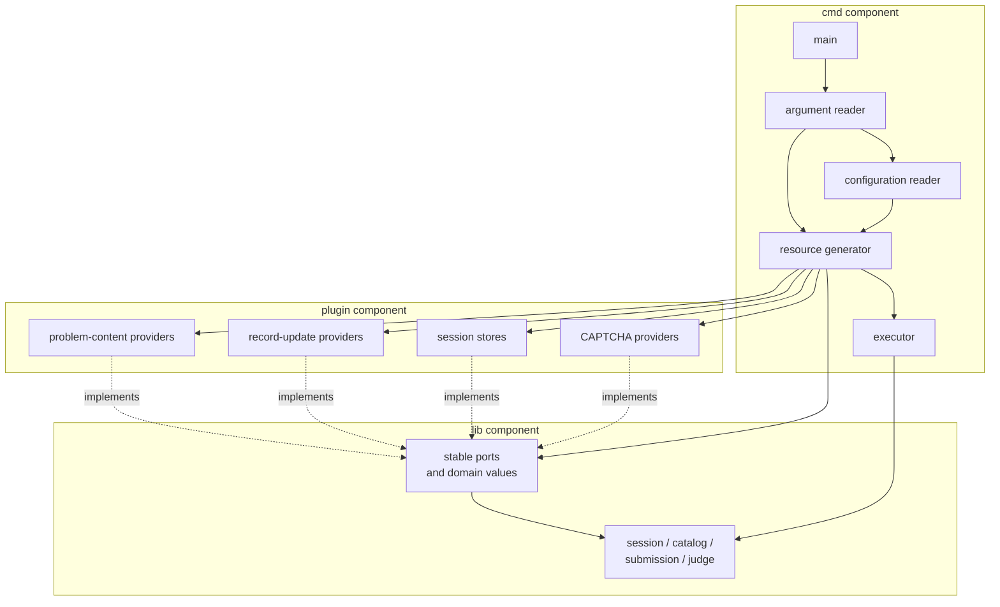
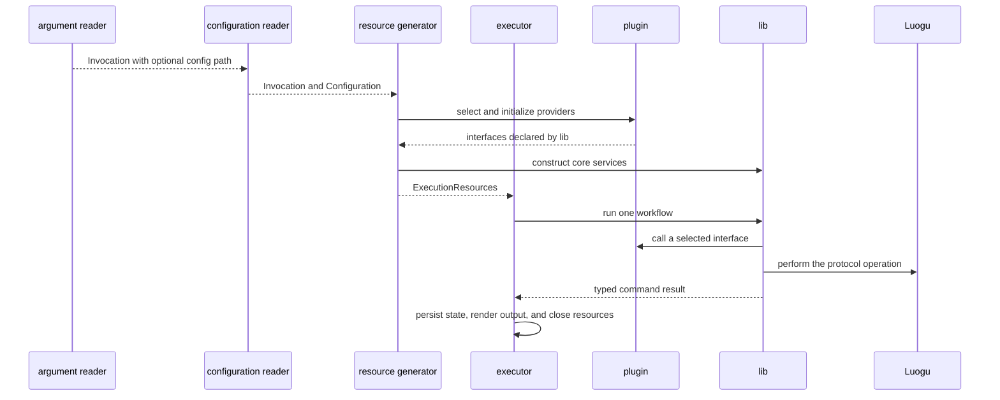
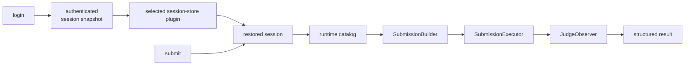

# LGC Design

## Status

Status: draft for review.

This document is the entry point for the LGC design. LGC is a Go Luogu client
whose primary consumers are command-line workflows and LLM-driven tools. The
repository does not yet contain an implementation; the Go declarations in the
detailed documents describe intended boundaries rather than an existing API.
The [Luogu upstream API reference](upstream.md) remains authoritative for
observed upstream behavior.

## Scope

The initial product exposes two commands:

- `login`, which authenticates a profile and persists an explicit session
  snapshot;
- `submit`, which submits source code and waits for a judge result.

The reusable library also contains an optional problem-content loader. It is
not exposed by the initial CLI.

Answer-file submission, contest submission, alternate login providers, and
unverified interactive challenge protocols are out of scope.

## Component model

The system has three top-level components:

| Component | Role | May depend on |
|---|---|---|
| `cmd` | Executable and composition root; reads invocation input, generates runtime resources, and executes one workflow | `lib`, `plugin` |
| `lib` | Common library; owns domain values, stable ports, public workflows, and protocol policy | External modules and its own packages |
| `plugin` | Concrete implementations of library ports | `lib` |

The `cmd` component is itself a one-way pipeline of four internal components:
an argument reader, a configuration reader, a resource generator, and an
executor. The configuration reader consumes the argument reader's invocation
because a later command-line option will let the user select the configuration
file location. The resource generator depends on both reads, and the executor
receives only the generated execution bundle.

The dependency direction is deliberate:

- `cmd` references both `lib` and `plugin`.
- `plugin` implements interfaces declared by `lib`.
- `lib` never imports `cmd` or a concrete plugin.
- A plugin never imports `cmd`; command concerns stay outside the extension API.

The component boundary is also an execution boundary:

## Module map

Details are kept in module-specific documents so the overview remains stable
while implementation decisions evolve.

| Module | Responsibility | Detailed design |
|---|---|---|
| Command provider | Four-stage CLI pipeline: argument read, configuration read, resource generation, execution, output, and exit status | [cmd.md](design/cmd.md) |
| Common library | Public contracts, package boundaries, shared invariants, and core workflow integration | [lib.md](design/lib.md) |
| Plugin provider | Provider contract, registration, selection, lifecycle, compatibility, and built-in adapters | [plugin.md](design/plugin.md) |
| Authentication | Credentials, login exchange, independent user and session state, and session snapshots | [lib/auth.md](design/lib/auth.md) |
| HTTP transport | Shared client, connection reuse, cookies, CSRF, redirects, and request lifetime | [lib/transport.md](design/lib/transport.md) |
| Runtime catalog | Runtime language and record-status metadata, immutable snapshots, and lookups | [lib/catalog.md](design/lib/catalog.md) |
| Problem model | Problem identity, optional content, and the problem-loader boundary | [lib/problem.md](design/lib/problem.md) |
| Submission | Parameter construction, serialization, CAPTCHA retry, and execution | [lib/submission.md](design/lib/submission.md) |
| Judge observation | Record snapshots, optional pushed updates, reduction, polling, and timeout semantics | [lib/judge.md](design/lib/judge.md) |
| CAPTCHA providers | Shared solver contract, external-command implementation, and multimodal-API implementation | [plugin/captcha.md](design/plugin/captcha.md) |

## End-to-end flows

The CLI is intentionally thin. It selects components but does not duplicate
library policy.

Two rules apply to every flow:

1. Parsers and adapters produce plain values. Core policy is applied once by
   the library component that owns it.
2. A plugin supplies an implementation at a port; it does not redefine core
   submission, authentication, or record-merging rules.

## Crosscutting invariants

- Submission construction is the only layer that resolves a language, checks
  O2 capability, trims source once, and fills final submission parameters.
- Runtime language IDs, disabled flags, O2 capability, and record statuses are
  read from upstream configuration rather than compiled in as permanent
  enumerations.
- HTTP record snapshots are canonical. Optional pushed updates accelerate
  observation and never replace the polling recovery path.
- Passwords, CAPTCHA answers, cookies, and CSRF values are transient secrets.
  They are never included in normal output, errors, metrics, or documentation.
- `lib` has no process-global mutable state. `cmd` owns process lifetime and
  selected provider lifetime.
- Plugin selection is deterministic. Missing, duplicate, or incompatible
  providers fail before a command performs network work.
- All blocking operations accept cancellation through `context.Context`.

## Design decisions

1. The extension unit is a typed provider, not a bag of unrelated callbacks.
2. Service interfaces live with `lib`; concrete implementations live in
   `plugin`.
3. `cmd` is the only composition root.
4. First-release providers are registered at build time. This avoids Go dynamic
   library ABI and platform constraints; the same capability boundaries can
   support a separate process protocol later.
5. Core protocol workflows remain ordinary library code rather than plugin
   implementations. CAPTCHA recognition, session persistence, pushed record
   updates, and optional problem-content loading are replaceable boundaries.
6. CAPTCHA has two interchangeable implementations: an external command that
   receives an image path, and a multimodal API client. The selected
   implementation never changes submission retry policy.
7. `cmd` composes resources before execution and runs exactly one command. Its
   argument, configuration, resource, and executor layers communicate in one
   direction; the executor never reads arguments or configuration again.

## Open technical risks

- The runtime `_version` used by `GET /_lfe/config/auth` still needs a stable
  discovery strategy.
- WebSocket subscription, heartbeat, and reconnect semantics remain unverified.
- CAPTCHA recognition quality, command-provider isolation expectations,
  multimodal protocol selection, model latency, cost, and external image
  handling require empirical validation and explicit user configuration.
- The secure session-store implementation needs a platform-specific decision.
- Dynamic third-party plugins would require serialization, isolation, and a
  separate compatibility policy; they are not part of the first release.

## Review checklist

- [ ] Each component respects the dependency direction in the architecture
      diagram.
- [ ] The `cmd` argument, configuration, resource, and executor stages keep
      their documented input, output, and lifecycle ownership boundaries.
- [ ] Each crosscutting rule has one authoritative module.
- [ ] Every plugin implements an interface declared by `lib`.
- [ ] Command behavior does not add a second validation or policy layer.
- [ ] Upstream claims link to evidence rather than being inferred from this
      design.
