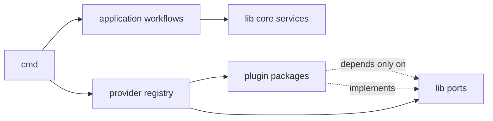
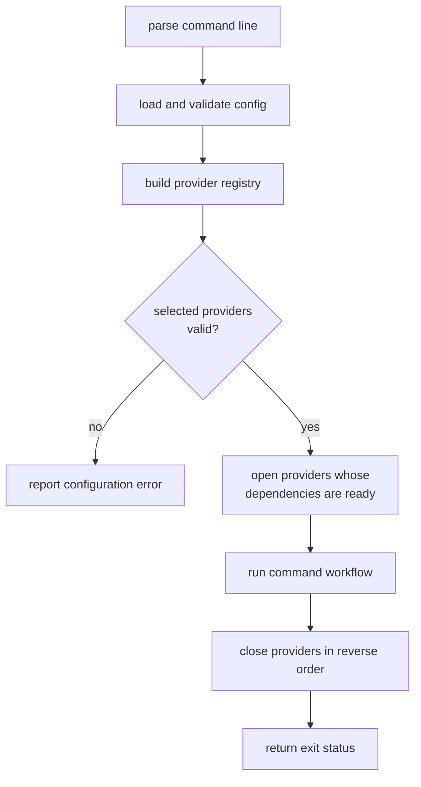
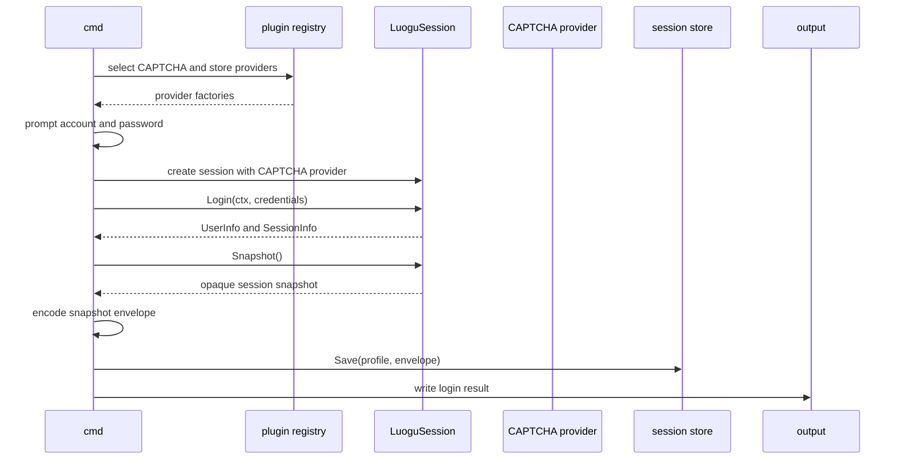
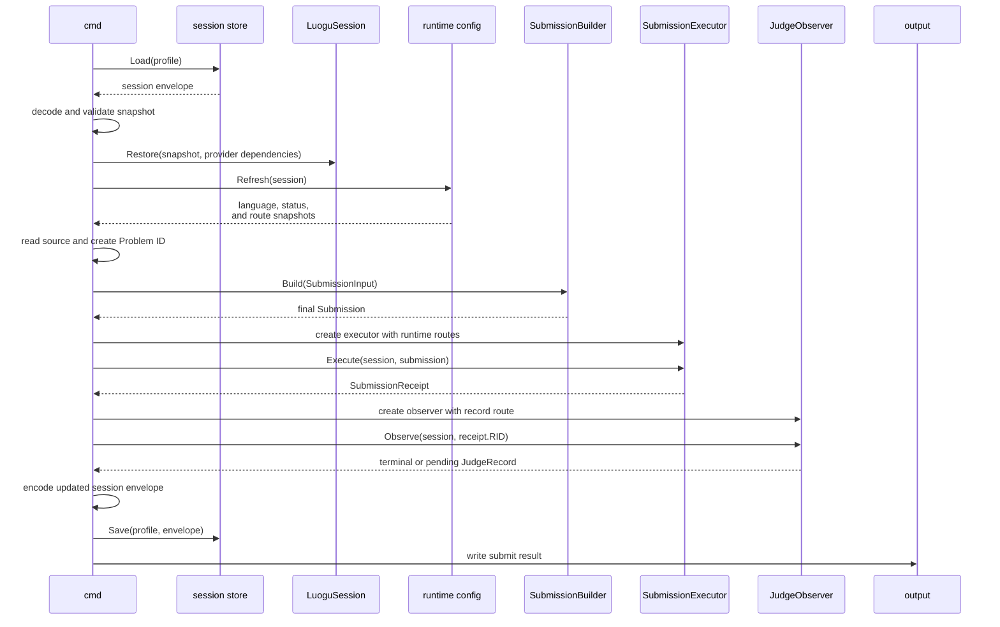

# Command Provider

## Responsibility

The `cmd` component is the executable and the only composition root. It turns
process input into library operations by selecting providers and passing
dependencies into core services.

It owns:

- argument parsing and command dispatch;
- non-secret configuration loading;
- plugin discovery, selection, and initialization;
- credential prompting;
- workflow orchestration;
- persistence of the final session snapshot;
- structured output, diagnostics, and exit status;
- graceful cancellation and cleanup.

It does not own language capability rules, submission parameter construction,
HTTP record merging, or protocol retry policy.

## Dependency direction



`cmd` imports `lib` and the providers distributed with LGC. A provider imports
only the public contracts and values it implements. No core package imports the
executable or a concrete provider.

## Proposed package structure

The repository layout is illustrative until implementation starts.

```text
cmd/
  lgc/
    main.go
  internal/
    app/
    config/
    pluginhost/
    output/
lib/
  ...
plugin/
  captcha/
  problem/
  recordupdate/
  sessionstore/
```

`cmd/lgc/main.go` contains process setup only. It sets signal cancellation,
creates the plugin host, and calls the application. Command logic lives under
`cmd/internal/app`; it is not exported as library API.

## Command surface

| Command | Required input | Optional input | Output |
|---|---|---|---|
| `login` | profile, account, hidden password prompt | configuration path | authenticated session snapshot |
| `submit` | problem ID, language, source file, saved profile | O2 request, timeouts, output mode | RID and final or pending judge result |

The password is never accepted as a normal command argument. Source input may
be read from a file or standard input, but it is not echoed. The initial
commands do not expose problem-content fetching.

## Configuration

Configuration is non-secret and separate from session state. The exact file
format remains an implementation decision; the logical schema is:

| Field | Purpose | Default |
|---|---|---|
| `profile` | Selects separate session state | `default` |
| `base_url` | Luogu origin | `https://www.luogu.com.cn` |
| `request_timeout` | Bound for one HTTP exchange | Finite |
| `judge_timeout` | Bound for terminal observation | Finite |
| `poll_interval` | Starting record-poll interval | Finite, with backoff |
| `plugins.captcha` | CAPTCHA provider ID | Required for `login`; used by `submit` when challenged |
| `plugins.session_store` | Session-store provider ID | Secure local default |
| `plugins.record_update` | Pushed-update provider ID | Optional; polling works without it |
| `plugins.problem_loader` | Problem-content provider ID | Unselected |
| `plugin_config.<id>` | Provider-specific non-secret configuration | Provider-defined |

At start-up, `cmd` validates this logical schema, checks provider IDs and API
versions, and fails before login or submission when selection is ambiguous.
Provider configuration is passed as plain data. Plugins do not read the main
configuration file themselves.

Secret-bearing provider settings use references such as `env:<NAME>`, not
literal values. `cmd` resolves a selected provider's references at construction
time and passes a redacted secret value. It never writes resolved secrets back
to configuration or includes them in provider diagnostics. The first release
supports only the `env:` reference scheme; other schemes are rejected until a
keychain or file-backed resolver has its own design.

## Startup order



Provider registries are immutable after selection. Session-bound factories,
such as record updates or problem loading, open only after the session they use
has been created. Services with operation-scoped state are closed at the end of
that operation, and process-scoped providers are closed at exit. Cleanup runs
even when command execution fails.

## Common application pipeline

1. Parse arguments into an `Invocation`.
2. Load non-secret configuration for the selected profile.
3. Resolve and initialize the required providers.
4. Create or restore a `LuoguSession`.
5. Execute one application workflow.
6. Encode and save any updated session snapshot through the selected store.
7. Render exactly one structured result and a matching exit status.

Progress information goes to standard error. A structured result goes to
standard output. Errors may be shown as diagnostics, but secrets and source
text are redacted.

## `login`



The password exists only for the login operation. `cmd` does not retain it in
configuration, logs, or results. A successful login saves the returned
snapshot atomically. A failed login reports the failure without claiming that
the previous snapshot was replaced.

## `submit`



`cmd` performs these boundary translations without rechecking what the library
already established:

- source file contents become a string;
- the command-line O2 flag becomes a boolean request;
- the problem ID becomes a `Problem` with absent content;
- the selected language name or ID becomes `SubmissionInput.RequestedLanguage`;
- the final record becomes a stable result object.

The command never calls `ProblemLoader`, requests a problem page, or repeats the
language and O2 checks after `SubmissionBuilder.Build`.

## Result contract

The machine-readable result should have a versioned envelope. Example:

```json
{
  "schema_version": 1,
  "command": "submit",
  "ok": true,
  "data": {
    "problem_id": "<pid>",
    "rid": "<redacted-rid>",
    "language_id": 27,
    "o2_requested": true,
    "o2_effective": true,
    "status": 12,
    "terminal": true,
    "verdict": "Accepted",
    "score": 100
  }
}
```

The schema may omit unknown or unavailable safe fields. `o2_effective` comes
from the returned record, not from the request. A judge timeout is a partial
success: the result has `ok: false`, an error category such as `judge_timeout`,
and safe `data` containing `submit_accepted: true` and the accepted RID. It
must not discard the RID or relabel the submission itself as rejected.

## Exit status

The proposed categories are:

| Code | Meaning |
|---:|---|
| `0` | Command completed its requested operation |
| `1` | Unexpected internal failure |
| `2` | Invalid command line or configuration |
| `3` | Authentication, session, or plugin selection failure |
| `4` | Submission was not accepted or its response was malformed |
| `5` | Submission succeeded but observation timed out |

An exact mapping can be finalized with the command API, but categories must
remain stable enough for scripts to distinguish usage, authentication,
submission, and observation failures.

## Security and lifecycle

- Credentials and CAPTCHA answers are transient and never serialized.
- CAPTCHA provider configuration selects exactly one strategy; there is no
  implicit fallback between a local program and an external model.
- Session snapshots are secret state, not configuration. The selected store
  writes them atomically with restrictive permissions.
- The command does not print cookies, CSRF tokens, CAPTCHA answers, source
  text, or full upstream error bodies.
- Context cancellation propagates to every network and provider operation.
- Sessions and selected providers close on all exit paths.
- A process receives one write path for structured output, preventing two
  producers from interleaving results.

## Tests

- `login` persists only the explicit snapshot and never the password.
- `submit` restores a snapshot and never requests the problem page.
- command parsing rejects missing required values before network access.
- provider selection fails deterministically for unknown, duplicate, or
  incompatible providers.
- timeout after a successful POST preserves and reports the RID.
- cancellation releases resources and emits no duplicate result.
- secrets do not appear in either output stream.
