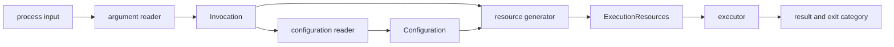
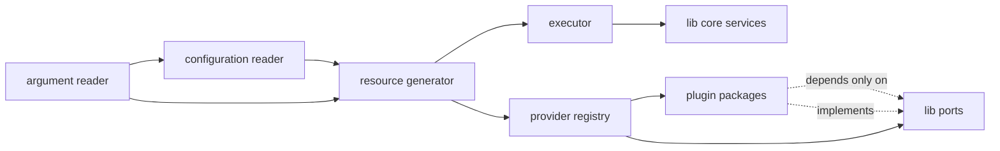
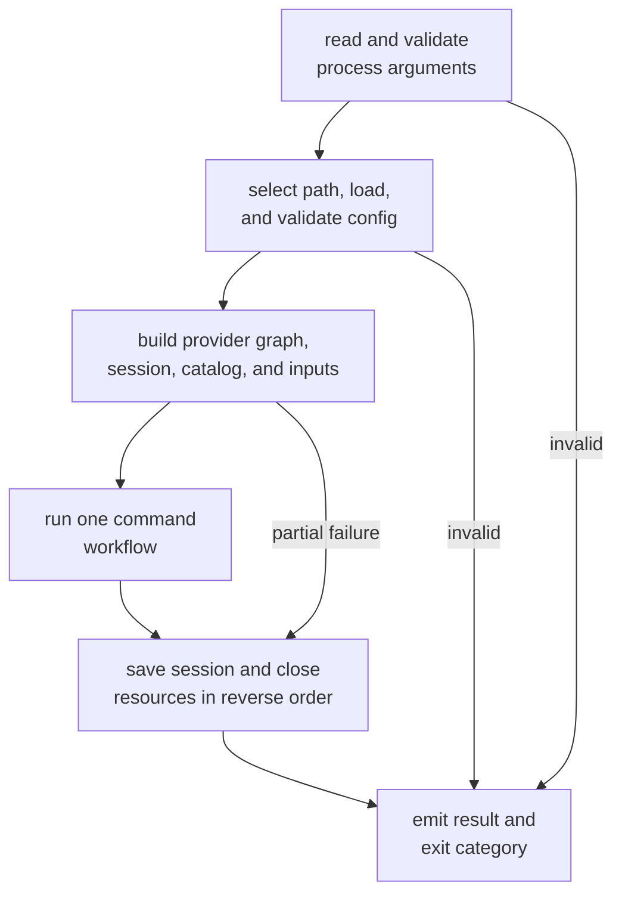
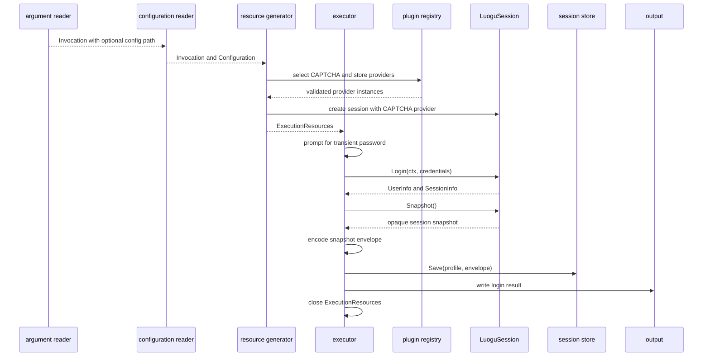
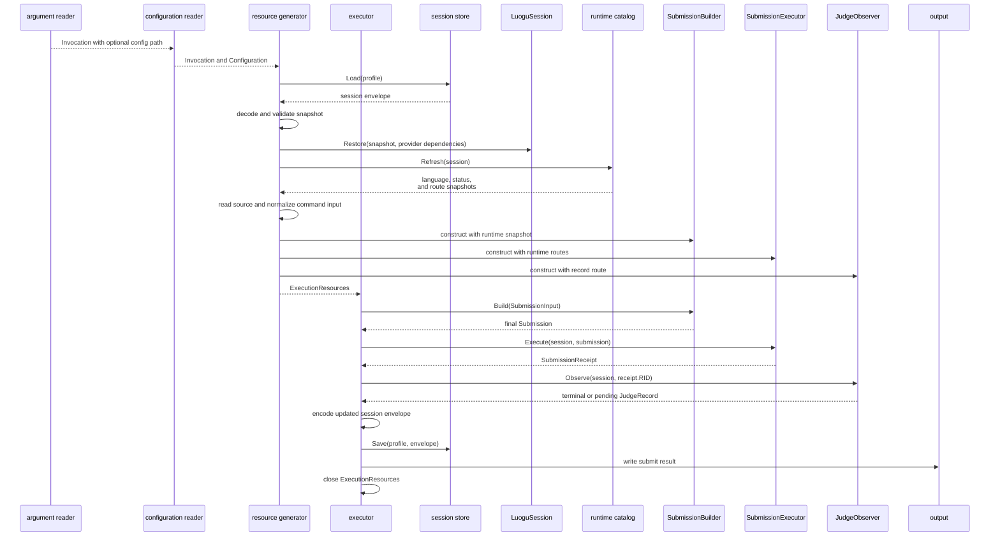

# Command Provider

## Responsibility

The `cmd` component is the executable and the only composition root. It turns
process input into at most one library workflow. Internally, `cmd` is a
one-way pipeline of four components:

1. the argument reader;
2. the configuration reader;
3. the resource generator;
4. the executor.

The argument reader owns the process-argument boundary. The configuration
reader consumes its result. The resource generator turns validated values into
live dependencies. The executor runs one command with those dependencies and
owns their cleanup.

`cmd` owns process input, configuration discovery, provider composition,
credential prompting, session persistence, output, and exit classification. It
does not own language capability rules, submission parameter construction, HTTP
record merging, or protocol retry policy.

In this document, a resource means an in-memory execution dependency or command
input, such as a provider instance, session store, restored session, runtime
catalog snapshot, or source input. It does not mean a generated build artifact
or a static asset.

## Internal components

The four components depend in one direction. A downstream component consumes
the output of an upstream component and never calls back into it.



The arrows describe data flow, not ownership of the command's business policy.
The `lib` core still owns protocol behavior after the executor invokes it.

### Argument reader

The argument reader is the only component that interprets raw process
arguments. It validates command grammar and required options and returns an
immutable `Invocation`.

The `Invocation` contains the selected command, normalized options, operands,
and the optional explicit configuration path. It distinguishes an omitted
configuration path from an explicitly supplied one. Parsing does not open
files, inspect sessions, prompt for secrets, or perform network access.

Static outcomes such as help and version output may complete at this stage.
All other invocations proceed to configuration reading. An argument error is
reported before any file or network work.

### Configuration reader

The configuration reader consumes an `Invocation` and returns an immutable
`Configuration`. It is downstream of the argument reader because the eventual
user-defined configuration location is a command-line concern.

The reader selects the explicit path from `Invocation.ConfigPath` when present.
Otherwise, it applies the default-path policy. It loads and validates
non-secret configuration, including the logical schema and the shape of
provider selectors. It does not inspect command operands, read source files,
restore sessions, resolve secret environment references, or construct
providers. Concrete provider IDs and API compatibility are checked by the
resource generator against the bundled registry.

An explicitly selected file that cannot be read or validated is an error. The
configuration reader must not hide that error by silently falling back to a
default file.

### Resource generator

The resource generator consumes one validated `Invocation` and
`Configuration`. It creates an `ExecutionResources` bundle containing the live
dependencies and normalized command input needed by exactly one executor run.

For the selected command, generation may:

- register bundled providers in an immutable typed registry;
- check selected provider IDs and extension API versions;
- resolve secret references such as `env:<NAME>` at construction time;
- open selected process-scoped providers;
- open the selected session store;
- create a fresh session for `login`, or load and restore a session for
  `submit`;
- refresh the runtime catalog for `submit`;
- read non-interactive source input for `submit`;
- construct the `SubmissionBuilder`, `SubmissionExecutor`, and `JudgeObserver`
  with one coherent runtime snapshot;
- keep an ordered close stack for every resource successfully opened.

Resource generation does not perform login, submit source code, wait for a
judge result, or write the final user result. It either returns a complete
bundle or closes every partially created resource and returns an error.

The bundle is owned exclusively by the executor after a successful return. It
contains no literal password. Secret values resolved for provider construction
are redacted from diagnostic representations.

### Executor

The executor consumes one `ExecutionResources` bundle and runs one command. It
prompts for transient credentials only when the selected workflow needs them.
For `login`, it calls the authentication workflow and saves the returned
session snapshot. For `submit`, it builds, executes, and observes one
submission against the prepared snapshot and runtime catalog.

The executor owns the final session save, structured result, diagnostics, exit
category, cancellation handling, and resource cleanup. It never reparses
arguments, rereads configuration, selects another provider, or repeats checks
already performed by `lib`.

The executor closes the bundle on every path, including failure and
cancellation. Close order is the reverse of successful construction order.

## Dependency direction



The argument package must not import configuration, resource, or execution
packages. The configuration package may import argument values. The resource
package may import argument and configuration values. The executor consumes
the resource package's execution bundle. No component imports an earlier
component's implementation package to reach process state.

`cmd` imports `lib` and the providers distributed with LGC. A provider imports
only the public contracts and values it implements. No core package imports
the executable or a concrete provider.

## Proposed package structure

The repository layout is illustrative until implementation starts.

```text
cmd/
  lgc/
    main.go
  internal/
    arguments/
    configuration/
    resources/
    executor/
lib/
  ...
plugin/
  captcha/
  problem/
  recordupdate/
  sessionstore/
```

`cmd/lgc/main.go` contains process setup only. It sets signal cancellation,
invokes the four pipeline stages, and returns the executor's exit category.
Command logic lives under `cmd/internal`; it is not exported as library API.

## Command surface

| Command | Required input | Optional input | Output |
|---|---|---|---|
| `login` | profile, account, hidden password prompt | global `--config <path>` | authenticated session snapshot |
| `submit` | problem ID, language, source file, saved profile | global `--config <path>`, O2 request, output mode | RID and final or pending judge result |

The password is never accepted as a normal command argument. Source input may
be read from a file or standard input, but it is not echoed. The initial
commands do not expose problem-content fetching.

## Configuration

Configuration is non-secret and separate from session state. The exact file
format remains an implementation decision; the logical schema is:

| Field | Purpose | Default |
|---|---|---|
| `profile` | Selects separate session state | `default` |
| `base_url` | Luogu origin | `https://www.luogu.com.cn` |
| `request_timeout` | Bound for one HTTP exchange | Finite |
| `judge_timeout` | Bound for terminal observation | Finite |
| `poll_interval` | Starting record-poll interval | Finite, with backoff |
| `plugins.captcha` | CAPTCHA provider ID | Required for `login`; used by `submit` when challenged |
| `plugins.session_store` | Session-store provider ID | Secure local default |
| `plugins.record_update` | Pushed-update provider ID | Optional; polling works without it |
| `plugins.problem_loader` | Problem-content provider ID | Unselected |
| `plugin_config.<id>` | Provider-specific non-secret configuration | Provider-defined |

The configuration reader validates this logical schema. The resource generator
then checks selected provider IDs and API versions against the bundled registry
and fails before login or submission when selection is ambiguous. Provider
configuration is passed as plain data. Plugins do not read the main
configuration file themselves.

Secret-bearing provider settings use references such as `env:<NAME>`, not
literal values. The resource generator resolves a selected provider's
references at construction time and passes a redacted secret value. It never
writes resolved secrets back to configuration or includes them in provider
diagnostics. The first release supports only the `env:` reference scheme; other
schemes are rejected until a keychain or file-backed resolver has its own
design.

## Startup order



Provider registries are immutable after selection. Session-bound factories,
such as record updates or problem loading, open only after the session they use
has been created. Services with operation-scoped state are closed at the end of
that operation, and process-scoped providers are closed at exit. Cleanup runs
even when command execution fails. A failed resource generator closes only the
resources it successfully created; a bundle returned to the executor is owned
by the executor.

## Common application pipeline

1. The argument reader converts process arguments into an `Invocation`.
2. The configuration reader uses the invocation's configuration path to produce
   a validated `Configuration`.
3. The resource generator creates one command-specific
   `ExecutionResources` bundle.
4. The executor runs the selected workflow, saves any updated session snapshot,
   renders exactly one result, returns an exit category, and closes the bundle.

Progress information goes to standard error. A structured result goes to
standard output. Errors may be shown as diagnostics, but secrets and source
text are redacted.

## `login`



The password exists only for the login operation. `cmd` does not retain it in
configuration, logs, or results. A successful login saves the returned
snapshot atomically. A failed login reports the failure without claiming that
the previous snapshot was replaced.

## `submit`



The resource generator performs these boundary translations without rechecking
what the library already established:

- source file contents become a string;
- the command-line O2 flag becomes a boolean request;
- the problem ID becomes a `Problem` with absent content;
- the selected language name or ID becomes `SubmissionInput.RequestedLanguage`;

The executor converts the final record into a stable result object.

The command never calls `ProblemLoader`, requests a problem page, or repeats the
language and O2 checks after `SubmissionBuilder.Build`.

## Result contract

The machine-readable result should have a versioned envelope. Example:

```json
{
  "schema_version": 1,
  "command": "submit",
  "ok": true,
  "data": {
    "problem_id": "<pid>",
    "rid": "<redacted-rid>",
    "language_id": 27,
    "o2_requested": true,
    "o2_effective": true,
    "status": 12,
    "terminal": true,
    "verdict": "Accepted",
    "score": 100
  }
}
```

The schema may omit unknown or unavailable safe fields. `o2_effective` comes
from the returned record, not from the request. A judge timeout is a partial
success: the result has `ok: false`, an error category such as `judge_timeout`,
and safe `data` containing `submit_accepted: true` and the accepted RID. It
must not discard the RID or relabel the submission itself as rejected.

## Exit status

The proposed categories are:

| Code | Meaning |
|---:|---|
| `0` | Command completed its requested operation |
| `1` | Unexpected internal failure |
| `2` | Invalid command line or configuration |
| `3` | Authentication, session, or plugin selection failure |
| `4` | Submission was not accepted or its response was malformed |
| `5` | Submission succeeded but observation timed out |

An exact mapping can be finalized with the command API, but categories must
remain stable enough for scripts to distinguish usage, authentication,
submission, and observation failures.

## Security and lifecycle

- Credentials and CAPTCHA answers are transient and never serialized.
- CAPTCHA provider configuration selects exactly one strategy; there is no
  implicit fallback between a local program and an external model.
- Session snapshots are secret state, not configuration. The selected store
  writes them atomically with restrictive permissions.
- The command does not print cookies, CSRF tokens, CAPTCHA answers, source
  text, or full upstream error bodies.
- Context cancellation propagates to every network and provider operation.
- Sessions and selected providers close on all exit paths.
- A process receives one write path for structured output, preventing two
  producers from interleaving results.
- Secret references are resolved only while generating selected resources and
  never appear in the resolved configuration model.

## Tests

- `login` persists only the explicit snapshot and never the password.
- `submit` restores a snapshot and never requests the problem page.
- the argument reader rejects missing required values before file or network
  access;
- the configuration reader uses an explicit path from the invocation and does
  not fall back when that file is invalid;
- provider resolution and configuration parsing remain in their respective
  components;
- resource generation closes every partially opened resource on failure;
- the executor never reparses arguments, rereads configuration, or selects a
  provider;
- provider selection fails deterministically for unknown, duplicate, or
  incompatible providers;
- timeout after a successful POST preserves and reports the RID;
- cancellation releases resources and emits no duplicate result;
- secrets do not appear in either output stream.
