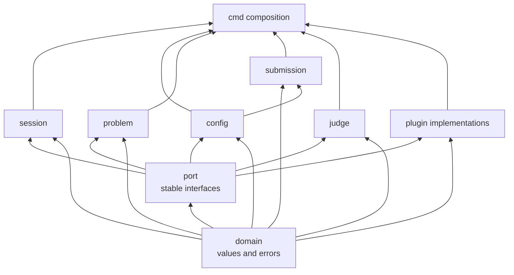
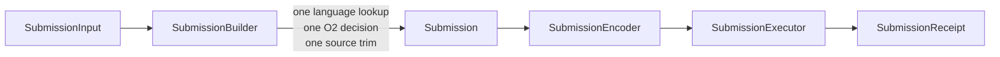

# Common Library

## Responsibility

The `lib` component contains the reusable Luogu client behavior and the
interfaces consumed by providers. It is usable without the LGC command-line
application.

It owns:

- immutable domain values shared across workflows;
- stable provider ports;
- authenticated HTTP transport and session state;
- runtime language and record-status catalogs;
- problem identity and optional problem loading;
- submission construction and execution;
- judge-record acquisition and reduction;
- typed errors and cancellation behavior.

It does not own argument parsing, terminal presentation, configuration file
discovery, or selection of concrete providers.

## Package boundaries

```text
lib/
  domain/       plain values and typed error categories
  port/         interfaces implemented by plugins
  session/      authentication state and authorized HTTP access
  config/       runtime configuration parsing and catalogs
  problem/      problem value and optional loader
  submission/   construction, encoding, and execution
  judge/        observation, update merging, and polling
```

The dependency direction is:



Arrows point from an imported package to its consumer. `domain` and `port`
never import a core implementation package. Core packages therefore cannot
depend on a concrete plugin, and plugins do not need to import `cmd`.

## Public surface

The public surface is intentionally narrow:

| Area | Public value or operation | Detailed design |
|---|---|---|
| Session | create, restore, log in, snapshot, close, authorized request | [auth.md](lib/auth.md), [transport.md](lib/transport.md) |
| Runtime config | refresh and query immutable language/status snapshots | [catalog.md](lib/catalog.md) |
| Problem | data value and optional content-loader port | [problem.md](lib/problem.md) |
| Submission | build, encode, execute, receive a RID | [submission.md](lib/submission.md) |
| Judge | observe, reduce snapshots and updates, polling fallback | [judge.md](lib/judge.md) |
| Providers | typed extension interfaces and descriptors | [plugin.md](plugin.md) |

Constructors accept dependencies explicitly. Library calls do not consult
global registries, process environment variables, or package-level mutable
configuration.

## Core versus extension

An interface is not automatically a plugin API. Only interfaces designed for
out-of-package implementations are stable ports.

| Concern | Classification | Reason |
|---|---|---|
| `CaptchaSolver` | Public port | Recognition strategy and human interaction vary by caller |
| `SessionStore` | Public port | Secure storage differs by platform and deployment |
| `RecordUpdateSource` | Public port | WebSocket, long polling, or disabled updates are transport choices |
| `ProblemLoader` | Public port | Content parsing is optional and can use a different representation |
| `HTTPDoer` | Internal seam | It supports tests and transport composition; plugins must not replace the session transport arbitrarily |
| `SubmissionEncoder` | Core implementation seam | The upstream request shape belongs to the submission protocol |
| `SubmissionExecutor` | Core workflow | CAPTCHA branching and duplicate-submission safety are LGC policy |
| `RecordReducer` | Core implementation | Snapshot precedence and terminal monotonicity are protocol rules |

Core code may use internal interfaces for testing, but exporting every seam as
a plugin contract would freeze implementation details and split policy across
components.

## Submission flow

The central pipeline separates construction policy from execution:



`SubmissionBuilder` is the only submission type allowed to consult the language
catalog or evaluate O2 capability. The encoder serializes final values. The
executor performs the exchange and only the verified CAPTCHA branch; it does
not repeat construction checks.

## Authentication and transport ownership

`LuoguSession` owns the cookie jar, authenticated state, CSRF state, and one
reusable HTTP transport. It does not own the language catalog or the
record-update lifecycle.

The session exposes authorized request operations to core workflows and
selected capability providers. A provider receives only the narrow access it
needs. It must not create a second cookie jar or persist request secrets.

## Error model

Errors use stable categories so `cmd` can choose an exit status while callers
can use `errors.Is` and `errors.As`.

| Category | Meaning |
|---|---|
| `ErrUsage` | Command/configuration shape is invalid; normally raised by `cmd` |
| `ErrUnauthenticated` | Required user or session state is missing, expired, or rejected |
| `ErrInvalidLanguage` | Requested language is unknown or disabled |
| `ErrO2Unsupported` | Runtime metadata says the selected language cannot use O2 |
| `ErrSubmissionRejected` | Upstream rejected a structurally valid submission |
| `ErrCaptchaRequired` | A challenge needs user/provider action and was not completed |
| `ErrMalformedUpstream` | A response does not match the verified envelope |
| `ErrJudgeTimeout` | Submission has a RID but observation did not reach a terminal record |
| `ErrPlugin` | A selected provider is missing, incompatible, or failed |

Concrete errors add safe context and wrap these categories. They never include
credentials, cookies, CSRF tokens, CAPTCHA answers, source text, or unsanitized
response bodies.

## Concurrency and lifetime

- Session state and cookie mutations are synchronized.
- Catalogs publish immutable snapshots atomically.
- `SubmissionBuilder` observes one coherent catalog snapshot per build.
- `Submission` is immutable after construction and passed by value.
- `SubmissionExecutor` does not mutate request parameters.
- `JudgeObserver` serializes merge operations for one record.
- Provider methods follow the cancellation and concurrency contract in
  [plugin.md](plugin.md).
- Network operations borrow a live session. Owners keep it alive until the
  operation or provider subscription finishes.

## Library tests

- No core package imports `cmd` or `plugin`.
- A fake provider can replace each public port without changing core packages.
- Catalog replacement never exposes a partially updated snapshot.
- Construction applies language, O2, and trim policy once.
- Execution and encoding do not query the catalog.
- Record snapshots cannot regress a terminal state.
- Context cancellation reaches HTTP and provider operations.
- Error formatting never renders a secret-bearing value.
