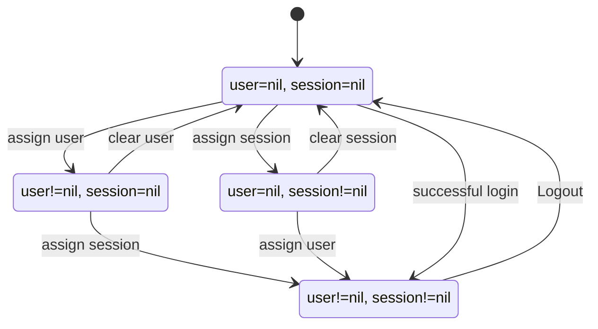
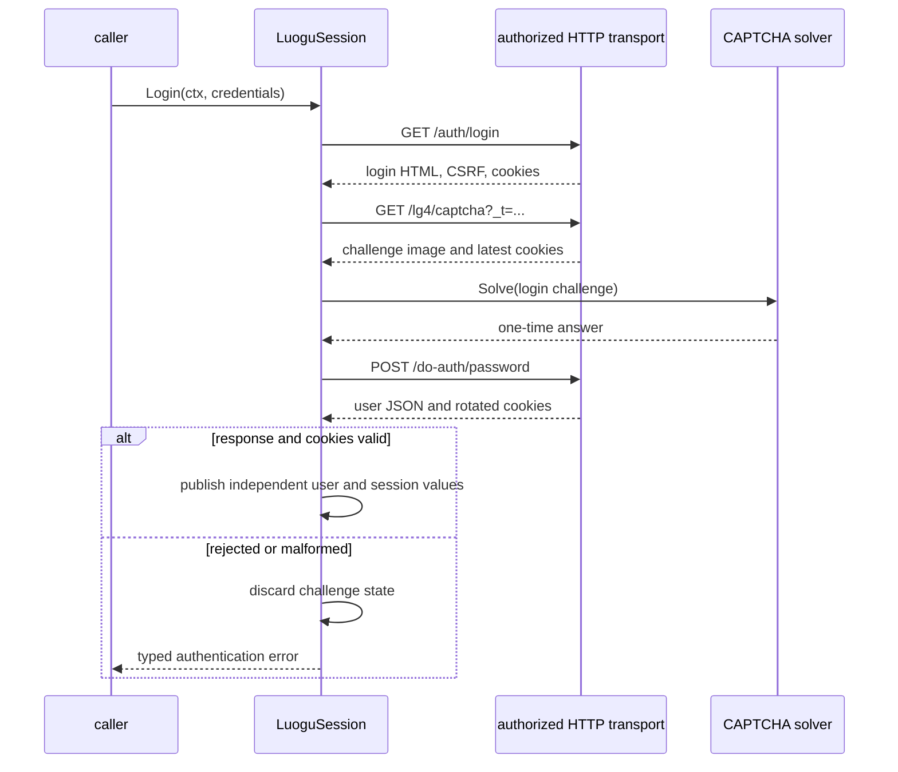

# Authentication and Session

## Responsibility

Authentication turns caller-supplied credentials and a CAPTCHA solver into
explicit user and session state. `LuoguSession` then provides authorized HTTP
access and a secret snapshot for persistence.

The module does not select a session-store provider, collect terminal input, or
own language metadata.

## State model

`UserInfo` and `SessionInfo` are independent nullable values.

```go
type Credentials struct {
	Account  string
	Password string
}

type UserInfo struct {
	Account string
	Locked  bool
}

type SessionInfo struct {
	cookies   []byte // opaque secret
	csrfToken string // secret
	syncToken string // optional secret
}

type SessionSnapshot struct {
	// private state
}

type LuoguSession struct {
	// private authenticated state
}
```

The fields illustrate state ownership; their concrete serialization is not a
public contract. Cookies and CSRF values never expose convenient formatting
that renders their contents.



One value does not imply the other. A restored snapshot can contain either
value alone. The operation that needs an authenticated cookie and CSRF token
checks the required state at the point of use and returns
`ErrUnauthenticated` when it is absent or rejected.

## Login flow



The library may fetch `/auth/login-methods` to validate the login method, but
the captured workflow does not establish that this call is mandatory for every
password login. Do not add it solely because the browser made it.

The login flow must:

1. preserve cookies from each preceding response;
2. read the CSRF meta token from HTML rather than substituting a cookie;
3. retain the latest `C3VK` cookie produced by the challenge flow;
4. pass only the challenge image, media type, and kind to the solver;
5. publish user and session state only after the response and required cookies
   validate;
6. discard one-time challenge state on failure.

See the [upstream authentication reference](../../upstream.md#authentication) for
request and response evidence.

## CAPTCHA boundary

`CaptchaSolver` is a public plugin port:

```go
type CaptchaSolver interface {
	Solve(ctx context.Context, challenge CaptchaChallenge) (string, error)
}
```

The session owns challenge acquisition, redirects, cookies, and expiry. The
solver recognizes an already-fetched image. It does not receive credentials,
session cookies, CSRF values, or the submission body.

Both login and risk-control submission challenges use the same interface but
carry a different `Kind`. A challenge and its answer are single-use. A retry
must obtain a fresh challenge when the previous one expired or was rejected.

The command CAPTCHA provider writes the image to a restrictive temporary path,
passes that path as an argument, reads one answer, and deletes the file on all
exit paths. The multimodal CAPTCHA provider sends the image only to its
explicitly configured API and extracts one constrained answer. Both hide
credentials and challenge contents from ordinary output.

Their configuration, request shape, failure behavior, and security boundaries
are specified in [CAPTCHA Providers](../plugin/captcha.md).

## Session operations

The minimum public operations are:

```go
func NewSession(options SessionOptions) (*LuoguSession, error)
func RestoreSession(options SessionOptions, snapshot SessionSnapshot) (*LuoguSession, error)
func (s *LuoguSession) Login(ctx context.Context, credentials Credentials) error
func (s *LuoguSession) Logout() error
func (s *LuoguSession) Snapshot() SessionSnapshot
func (s *LuoguSession) Close() error
```

`NewSession` creates an empty session. `RestoreSession` creates one from an
explicit snapshot without performing network I/O. `Snapshot` copies the state;
later session mutations do not change the returned value.

`Close` is idempotent. It clears secret state and releases transport resources.
`Logout` clears local authenticated state even if a best-effort upstream logout
is unavailable.

## Session snapshots

User and session values belong to the explicit snapshot, never to ordinary CLI
configuration. A session-store plugin owns storage, but authentication owns the
snapshot shape.

Snapshot rules:

- include a schema version;
- serialize only the fields required to restore state;
- never include passwords or CAPTCHA answers;
- treat cookies, CSRF, and synchronization values as opaque bytes;
- reject unsupported versions instead of guessing fields;
- write through the store atomically and with restrictive permissions;
- never emit secret values through `%v`, `%+v`, logs, traces, or error text.

The snapshot fields are private. A versioned codec owned by this module converts
a snapshot to and from an opaque byte envelope. The session-store plugin sees
only those bytes, so it cannot accidentally depend on the internal layout of
user or cookie state.

```go
func EncodeSessionSnapshot(snapshot SessionSnapshot) ([]byte, error)
func DecodeSessionSnapshot(envelope []byte) (SessionSnapshot, error)
```

The envelope is not a promise that storage is encrypted. A store may add
encryption or platform keychain protection around the opaque bytes, but it
must validate and enforce restrictive access on its own storage layer.

Restoration does not claim that state is still valid upstream. The first
authorized operation can discover rejection and return `ErrUnauthenticated`.
An unsupported or corrupt envelope is reported as a session-state error; the
client does not silently discard it and continue as an empty session.

## Concurrency

One session may be used by concurrent HTTP operations. Authentication-state
read and mutation are synchronized, and the cookie jar serializes its own
updates. `Snapshot` acquires one coherent state view.

Login and logout are exclusive state transitions. Two simultaneous logins on
one session are rejected or serialized; they are never allowed to interleave
challenge state. Close and logout are idempotent.

## Errors

- Invalid credential input: a safe local validation error.
- Login method unavailable: `ErrUnauthenticated` with method context.
- CAPTCHA provider failure: `ErrCaptchaRequired` wrapping the provider error.
- Expired challenge: `ErrCaptchaRequired`; obtain a new challenge.
- Rejected credentials: `ErrUnauthenticated`.
- Malformed login envelope or missing rotated cookies: `ErrMalformedUpstream`.
- Missing required state before a request: `ErrUnauthenticated`.

Errors do not contain the account password or CAPTCHA answer.

## Tests

- User and session states can exist independently.
- A successful login publishes both only after required cookies exist.
- A failed login does not overwrite an existing valid snapshot in `cmd`.
- CAPTCHA cookies rotate and the latest `C3VK` value survives the flow.
- A solver receives no credentials or CSRF token.
- Expiry produces a new-challenge path rather than answer replay.
- Snapshot copy is immutable and restores without network access.
- Concurrent close, snapshot, and authorized requests are race-free.
- Error formatting never includes secret values.
