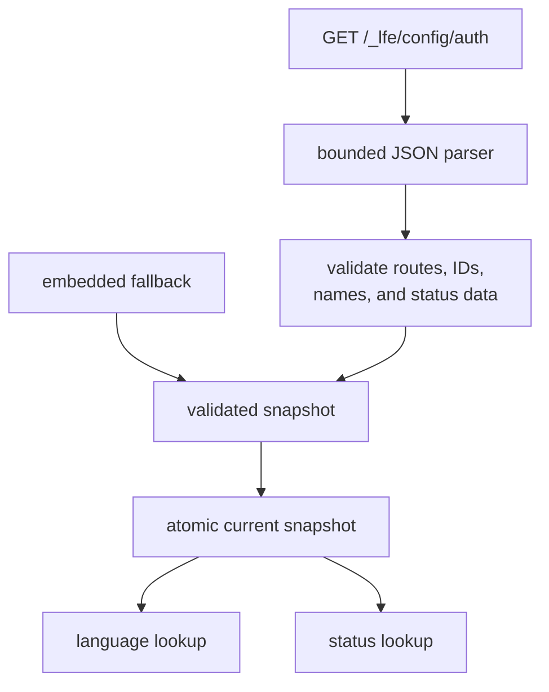

# Runtime Catalog

## Responsibility

The runtime catalog converts time-sensitive Luogu configuration into immutable
snapshots for language selection and judge-status interpretation.

It owns:

- fetching and parsing `GET /_lfe/config/auth`;
- runtime route templates;
- language metadata, including availability and O2 capability;
- record-status metadata, including terminality;
- the observed timestamp and provenance of a snapshot;
- atomic snapshot replacement.

It does not construct submissions, perform record observation, or contain a
network client for every caller.

## Why runtime data

Language IDs, disabled flags, O2 capability, and record statuses can change
without a client release. A compiled enumeration would eventually submit the
wrong language or misinterpret a record.

The offline snapshot is therefore a fallback and a test fixture. Before a
network submission, the CLI refreshes runtime configuration through an
authenticated session. Unknown or unproven O2 capability fails closed.

## Snapshot model

```go
type RuntimeSnapshot struct {
	ObservedAt time.Time
	Source     SnapshotSource
	Routes     map[string]string
	Languages  map[LanguageID]Language
	Statuses   map[int]RecordStatus
}

type Language struct {
	ID       LanguageID
	Name     string
	Family   string
	Disabled bool
	CanO2    bool
	FileExts []string
}

type RecordStatus struct {
	ID       int
	Type     string
	Short    string
	PollAgain bool
}
```

The snapshot is immutable after publication. Collections are copied on entry so
callers cannot mutate shared state.



## Loading

```go
type Loader interface {
	Refresh(ctx context.Context, session *LuoguSession) (RuntimeSnapshot, error)
}

type Catalog struct {
	// private atomic snapshot
}

func NewCatalog(initial RuntimeSnapshot) (*Catalog, error)
func (c *Catalog) Current() RuntimeSnapshot
func (c *Catalog) Replace(snapshot RuntimeSnapshot) error
func (c *Catalog) LookupLanguage(value string) (Language, bool)
func (c *Catalog) LanguageByID(id LanguageID) (Language, bool)
func (c *Catalog) RecordStatus(id int) (RecordStatus, bool)
```

`Refresh` uses the authenticated transport and a bounded response body. It
does not publish a partially parsed result. `Replace` validates the complete
candidate before one atomic swap.

`Current` returns an immutable snapshot value. Long-running operations capture
one snapshot at the start so a concurrent refresh cannot change a decision
halfway through.

### `_version` discovery

`GET /_lfe/config/auth` requires a `_version` query value supplied by the site's
client runtime. The captured endpoint does not return its own version, and the
evidence does not establish a standalone discovery endpoint.

The loader must obtain the version from a documented client-runtime source, or
return a diagnostic rather than inventing a constant. Options to evaluate
during implementation are:

- parse a version exposed by the authenticated root or login page;
- discover a same-origin runtime asset and extract its version;
- use a cached validated snapshot only for explicitly non-authoritative work.

No cached language snapshot is used to bypass a failed runtime refresh for a
new submission unless a later decision explicitly accepts stale metadata.

## Language lookup

`LookupLanguage` accepts:

- a decimal language ID as text;
- an exact, case-sensitive language name from the runtime snapshot.

It performs an exact lookup and returns `found=false` when no enabled mapping
exists. It never chooses a default language and never fuzzy-matches names.

Validation rejects:

- duplicate numeric IDs;
- duplicate names where name lookup would be ambiguous;
- missing IDs or names;
- invalid file-extension metadata if present.

Disabled languages remain available by explicit ID for diagnostics, but a
caller must check `Disabled` before submission. `SubmissionBuilder` performs
that check once as part of construction.

## O2 capability

`canO2` is language metadata, not an inference from language family. The
captured configuration showed O2 capability for Pascal, C, C++ variants, Rust,
Haskell, and OCaml, and no capability for Java, Python, Go, Node.js, and several
other entries.

The rules are:

- an O2 request is rejected when the language is missing;
- an O2 request is rejected when `Disabled` is true;
- an O2 request is rejected when `CanO2` is false;
- execution never relies on an HTTP 200 response to imply that O2 was applied;
- the result's effective O2 state comes from the returned record.

See the [upstream O2 evidence](../../upstream.md#o2-capability).

## Record statuses

Status IDs and display names come from `RecordStatus`. The client does not
hard-code a permanent verdict table.

The observed `Poll again` values identify status `0` and `1` as non-terminal
and the captured error/success statuses as terminal. They remain runtime data,
not an enum compiled into the reducer.

If a returned status is absent or its metadata is malformed, observation fails
with `ErrMalformedUpstream` instead of guessing that it is terminal. This avoids
returning a partial judge result as a verdict.

## Route templates

Routes are parsed from runtime configuration into named templates. The client
substitutes only validated path parameters such as `pid` or `rid`. Runtime
routes must remain same-origin HTTPS paths; a route that changes origin or
scheme is rejected unless a future security decision permits it.

Static protocol facts such as known headers remain code constants. Mutable
endpoint paths remain configuration.

## Atomicity and concurrency

- Parsing and validation happen outside the publish lock.
- Publication swaps one immutable snapshot.
- Readers never observe one map from an old snapshot and another from a new one.
- `ObservedAt` records when the upstream response was captured, not when a
  process started.
- A failed refresh leaves the previous snapshot intact and returns an error.

## Tests

- Embedded and runtime snapshots both validate through the same path.
- A malformed or partial refresh never replaces the current snapshot.
- Concurrent readers always observe a coherent snapshot.
- Numeric and exact-name lookup resolve the same language.
- Unknown and disabled languages remain distinguishable.
- O2 capability is taken from metadata, not family or name heuristics.
- Status terminality comes from `PollAgain`, not the numeric value alone.
- Runtime routes cannot redirect credentials to another origin.
