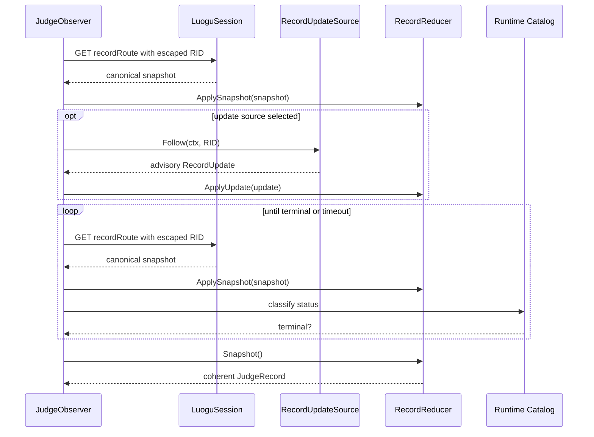
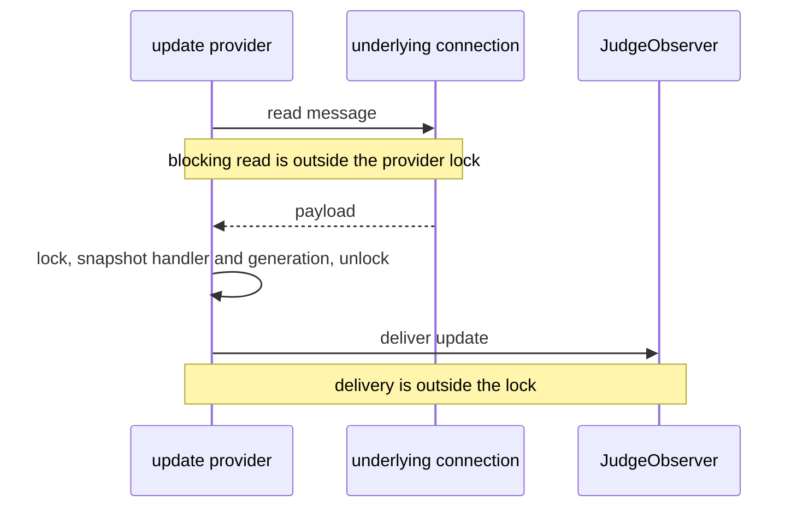

# Judge Observation

## Responsibility

Judge observation acquires the record for an accepted RID, merges optional
pushed updates, polls until a terminal runtime status, and returns one coherent
`JudgeRecord`.

`JudgeObserver` owns acquisition and policy. `RecordReducer` is an in-memory
component that turns canonical snapshots and advisory updates into one record.

The module does not construct submissions or define permanent status numbers.

## Inputs

```go
type JudgeObserver struct {
	session      *LuoguSession
	catalog      *Catalog
	recordRoute  string
	updateSource RecordUpdateSource // optional
	policy       ObservationPolicy
}

type ObservationPolicy struct {
	InitialPollDelay time.Duration
	MaxPollDelay     time.Duration
	PollTimeout      time.Duration
}

func (o *JudgeObserver) Observe(
	ctx context.Context,
	rid string,
) (JudgeRecord, error)
```

`recordRoute` comes from one validated runtime route snapshot. `updateSource`
is an optional public plugin port. When absent, observation uses HTTP polling
only. The policy controls delay, backoff, and a deadline local to observation;
it does not change submission timeouts.

## Record model

```go
type JudgeRecord struct {
	RID        string
	Status     RecordStatus
	LanguageID LanguageID
	EnableO2   bool
	Compile    CompileResult
	Judge      JudgeResult
	ReceivedAt time.Time
}

type RecordUpdate struct {
	RID       string
	Fields    map[string]json.RawMessage
	ReceivedAt time.Time
}
```

The concrete model can use typed fields rather than a generic map. It preserves
unknown safe fields only if the public result needs them later. Internal maps
are copied and never shared with callers.

## Observation flow



Observation always obtains or has a canonical snapshot before treating a pushed
update as useful. On reconnect or after a gap, it polls before trusting future
updates.

## Canonical snapshot precedence

HTTP record snapshots are canonical. Pushed updates are advisory and may be
partial, duplicated, stale, or out of order.

The reducer obeys these rules:

1. A snapshot for the same RID replaces prior snapshot-derived fields.
2. A terminal record never regresses to a non-terminal status.
3. A late update cannot overwrite fields supplied by a newer canonical
   snapshot.
4. Duplicate updates are idempotent.
5. Updates for a different RID are rejected.
6. Snapshot and update reads expose one coherent value, never a half-merge.

If upstream later exposes a monotonic record revision, the reducer can compare
it. The current verified data does not establish such a revision, so arrival
time and source precedence are explicit rather than guessed from status.

## Status classification

The runtime `RecordStatus` catalog decides whether to poll again.

- The captured configuration marks statuses `0` and `1` as `Poll again`.
- Captured terminal statuses include compile and judge outcomes such as `2`,
  `6`, and `12`.
- These numbers are observations, not permanent client enums.
- An unknown status is `ErrMalformedUpstream`; it is not silently terminal.

The top-level response envelope status and the record's judge status are
different fields. Only the record status controls observation.

`compileResult.success=false` on a pending record does not imply Compile Error.
The overall record must be terminal before the verdict is finalized.

## Polling

Polling is the required recovery path.

- Start with a finite configured delay.
- Apply bounded exponential backoff with jitter.
- Respect the caller's cancellation and the observation timeout.
- Bound and decode each response independently.
- Refresh CSRF through the normal idempotent GET path when required.
- Stop when the runtime catalog marks the current status terminal.
- Do not spin when the record endpoint returns a retryable failure; propagate
  or back off within the stated policy.

The initial HTTP read is deliberately separate from later polling. It provides
a baseline even when a pushed update arrives early.

## Timeout

When a valid RID exists but the observation deadline elapses:

- return the latest coherent `JudgeRecord`;
- return an error wrapping `ErrJudgeTimeout`;
- preserve `terminal=false` in the safe result representation;
- never discard the RID or relabel the submission as failed.

The CLI maps this case to its dedicated observation-timeout exit status.

## Optional pushed updates

The update provider implements the port in
[plugin.md](../plugin.md#record-update-source). The captured transport is a
WebSocket using a separate HTTP/1.1 upgrade connection from the main HTTP/2
requests.



Provider lifecycle rules:

- one reader owns the underlying read at a time;
- locks never cover blocking reads or callbacks;
- `Close` marks the provider closed and detaches the connection before closing;
- a generation value prevents late messages from an old connection;
- a closed channel is distinguishable from a temporary pause;
- provider work honors the observation context and does not outlive `Close`.

The captured evidence does not establish subscription messages, heartbeat
semantics, reconnect guarantees, or message ordering. The implementation does
not invent these. Any reconnect is bounded, obtains a fresh canonical poll, and
preserves polling as the source of truth.

After one decompressed frame, the capture observed:

```text
0x10 + "Record:<rid>" + 0x01 + <record-json>
```

That framing is verified for the capture, not all future messages. Unknown
frames are ignored or classified by the provider without turning them into
verdicts.

## Errors

| Error | Meaning |
|---|---|
| `ErrUnauthenticated` | Record endpoint rejects the session |
| `ErrMalformedUpstream` | Invalid envelope, missing record, or unknown status |
| `ErrJudgeTimeout` | RID remains valid but no terminal status was observed |
| Context cancellation/deadline | Caller canceled observation |
| Transport error | A poll could not complete |

An error from an optional pushed-update provider does not stop canonical
polling. If it is surfaced to the caller, it is marked non-fatal and never
replaces the terminal record. A canonical record read failure follows the
configured poll policy.

## Tests

- Polling-only observation reaches a terminal runtime status.
- Runtime status metadata, not a hard-coded list, controls termination.
- A pending compile result is not prematurely classified as Compile Error.
- Terminal records cannot regress under a late update.
- Stale updates do not overwrite newer canonical fields.
- Updates for another RID are rejected.
- The reducer is race-free under concurrent snapshot and update inputs.
- Observation timeout returns the latest record plus `ErrJudgeTimeout`.
- Cancellation closes the optional update subscription.
- Provider callbacks run outside locks.
- Reconnect or channel closure triggers a canonical poll before more updates
  are trusted.
