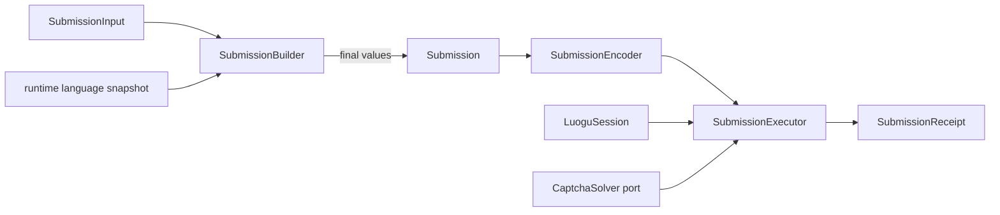
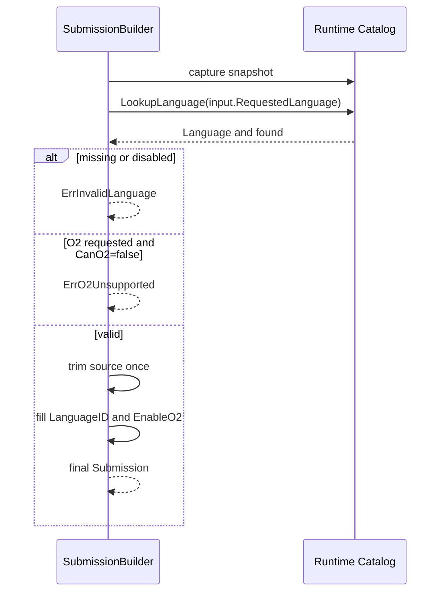
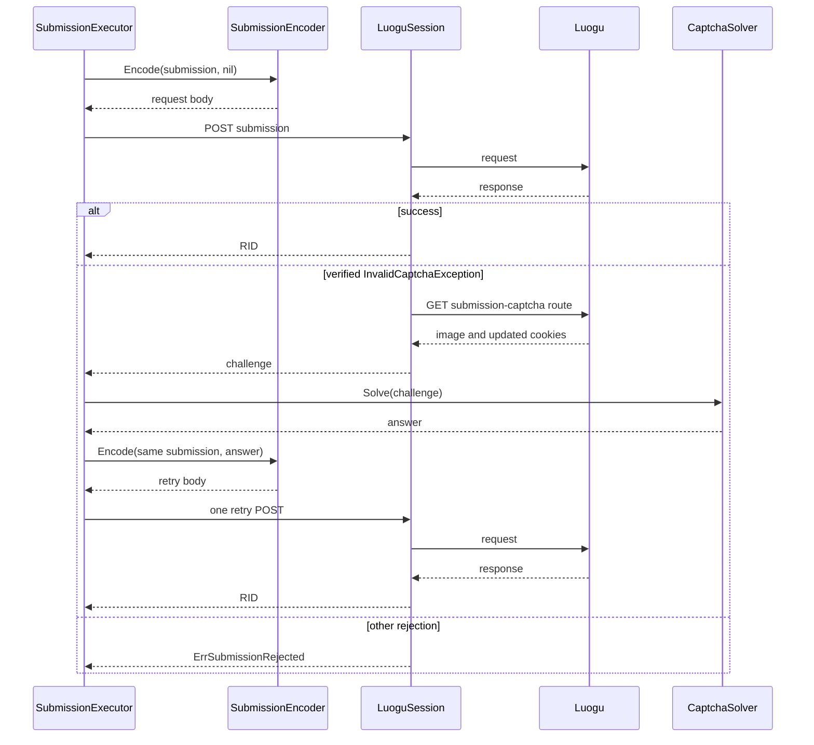

# Submission

## Responsibility

The submission module converts caller input into one final upstream request,
executes it, and returns a RID. It separates construction policy from
serialization and transport execution.

The module owns:

- language and O2 decisions during construction;
- one source trim during construction;
- final submission values;
- deterministic request serialization;
- the submission POST;
- the verified `InvalidCaptchaException` retry branch.

It does not fetch problem content, observe the final verdict, or select a
language provider from command-line state.

## Pipeline



No later stage repeats language lookup, O2 capability evaluation, source trim,
or source-content policy.

## Input and final values

```go
type SubmissionInput struct {
	Problem           Problem
	RequestedLanguage string
	Code              string
	RequestO2         bool
}

type Submission struct {
	Problem    Problem
	LanguageID LanguageID
	Code       string
	EnableO2   int
}

type SubmissionReceipt struct {
	RID string
}
```

`SubmissionInput` carries parsed caller values. `Submission` contains values
that are ready to encode. It has no validation, normalization, or network
methods. `EnableO2` is already normalized to `0` or `1`.

## Construction

```go
type SubmissionBuilder struct {
	catalog *Catalog
}

func NewSubmissionBuilder(catalog *Catalog) *SubmissionBuilder
func (b *SubmissionBuilder) Build(
	input SubmissionInput,
) (Submission, error)
```

`Build` performs exactly this sequence:

1. capture one current runtime catalog snapshot;
2. look up `RequestedLanguage` once;
3. reject a missing language with `ErrInvalidLanguage`;
4. reject a disabled language with `ErrInvalidLanguage`;
5. if `RequestO2` is true and `CanO2` is false, return
   `ErrO2Unsupported`;
6. trim the source once with `strings.TrimSpace`;
7. fill `LanguageID` and normalized `EnableO2`.



There is no default language. `RequestO2=false` always produces
`EnableO2=0`; `RequestO2=true` produces `EnableO2=1` only after the runtime
snapshot proves support.

Upstream can return HTTP 200 for an unsupported O2 request while the resulting
record reports `enableO2: false`. The client's runtime capability check remains
authoritative before the POST; execution never treats HTTP success as proof
that O2 was applied.

The builder does not reject an empty or whitespace-only source string. The
available upstream evidence does not establish a stable local content rule,
and silently adding one would create a second policy not represented by the
runtime data.

## Serialization

```go
type SubmissionEncoder interface {
	Encode(submission Submission, captcha *string) ([]byte, error)
}
```

The encoder maps final values directly:

```json
{
  "lang": 27,
  "code": "<final-code>",
  "enableO2": 1
}
```

When a CAPTCHA answer is present, it adds the verified `captcha` field:

```json
{
  "lang": 27,
  "code": "<final-code>",
  "enableO2": 1,
  "captcha": "<one-time-answer>"
}
```

The encoder must not:

- query or inspect a language catalog;
- inspect `CanO2`;
- trim or normalize source;
- reject empty source;
- choose a default language;
- change `EnableO2`;
- parse HTML problem content;
- add retry, authentication, or CAPTCHA policy.

Serialization is deterministic for one `Submission` and optional CAPTCHA
answer. The encoder is an internal implementation seam owned by `lib`, not a
public provider port, because the wire shape is part of LGC protocol policy.

## Execution

```go
type SubmissionExecutor struct {
	encoder SubmissionEncoder
	captcha CaptchaSolver // optional until a challenge is required
	routes  SubmissionRoutes
}

type SubmissionRoutes struct {
	Submit            string
	SubmissionCaptcha string
}

func (e *SubmissionExecutor) Execute(
	ctx context.Context,
	session *LuoguSession,
	submission Submission,
) (SubmissionReceipt, error)
```

Execution:

1. captures the current authorized session headers and CSRF state;
2. resolves the submitted path from the immutable runtime route snapshot;
3. encodes the submission without a CAPTCHA;
4. sends the first POST;
5. returns a RID on success;
6. enters the CAPTCHA branch only when HTTP 403 and the verified
   `InvalidCaptchaException` signal are both present;
7. fetches a fresh challenge from the runtime submission-captcha route;
8. asks the selected `CaptchaSolver` for one answer;
9. re-encodes the same `Submission` with that answer;
10. sends one retry;
11. validates and returns the resulting RID.



The executor does not inspect the language catalog, check O2 capability,
enforce source length, trim source, reject empty source, or fetch problem
content.

The problem ID is escaped and substituted as one path segment in the validated
submission route. A route cannot redirect the request to another origin.

## Retry safety

The only automatic replay is the verified CAPTCHA branch. It reuses the built
submission and adds the challenge answer. If that retry also fails, execution
returns an error.

No generic HTTP layer may retry a submission POST. A lost success response may
already have created a RID, so blind replay can create a duplicate submission.
If the first response is ambiguous, report the transport failure without
claiming that no submission occurred.

## RID handling

A successful submission response yields a non-empty opaque RID. The executor
does not parse it as a permanent numeric range or expose it in logs by default.

The RID is returned even when later judge observation times out. The CLI result
must preserve it so the caller can query the record later.

## Errors

| Error | Source |
|---|---|
| `ErrInvalidLanguage` | Builder found no enabled language |
| `ErrO2Unsupported` | Builder found false runtime `CanO2` |
| `ErrUnauthenticated` | Session cannot authorize submission or challenge |
| `ErrCaptchaRequired` | Challenge exists but no solver/valid answer is available |
| `ErrSubmissionRejected` | Upstream rejects the structurally valid request |
| `ErrMalformedUpstream` | Success envelope has no usable RID |
| Transport/TLS error | Shared HTTP transport |

Errors never include source text, cookies, CSRF values, or CAPTCHA answers.

## Tests

- The builder performs one catalog lookup per build.
- Unknown language fails before encoding.
- Disabled language fails before encoding.
- O2 requested with `CanO2=false` fails before any POST.
- O2 support is not inferred from language family.
- Source is trimmed exactly once.
- Whitespace-only source is not rejected by the library.
- The encoder does not read the catalog.
- The executor performs no construction-time checks.
- Submission and CAPTCHA paths come from one validated runtime route snapshot.
- CAPTCHA retry reuses the same final `Submission` and adds only the answer.
- A lost response is not submitted again.
- A RID survives judge timeout at the application boundary.
