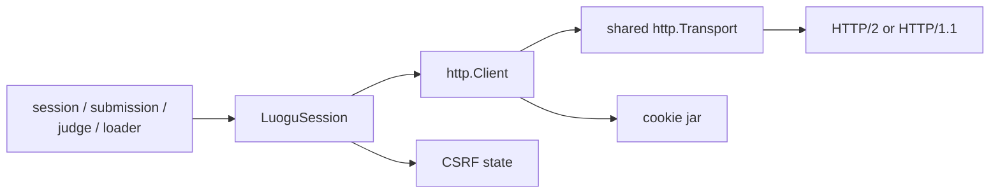
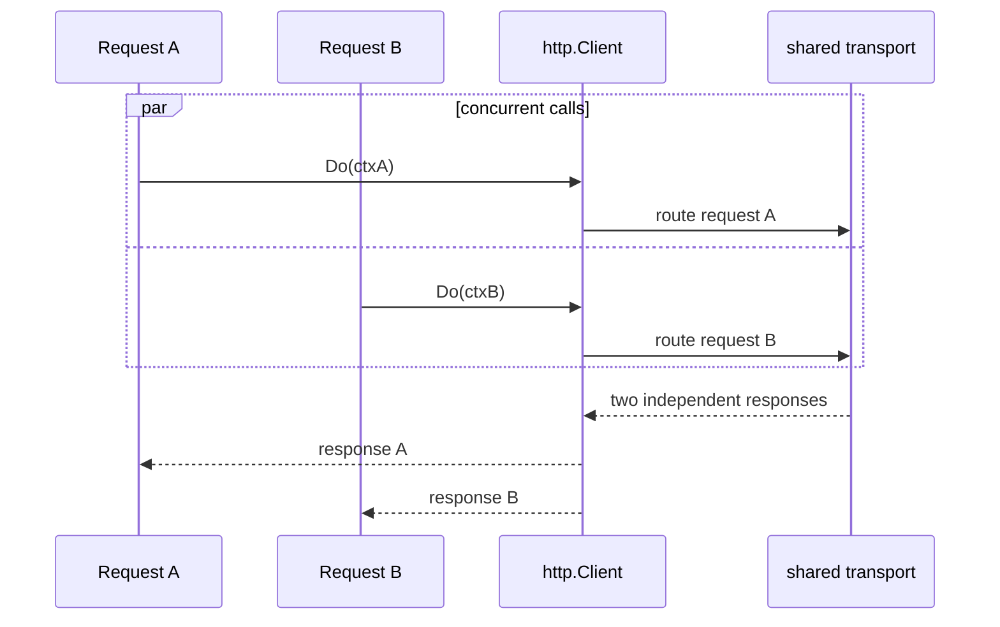

# HTTP Transport

## Responsibility

The transport module performs HTTP exchanges with one shared cookie jar and
consistent request headers. It is responsible for connection reuse, body
lifetime, redirect handling, CSRF injection, and safe error classification.

It does not own language resolution, submission validation, judge polling
policy, or provider selection.

## Components

`LuoguSession` owns:

- one `http.Client`;
- one reusable `http.Transport`;
- one cookie jar scoped to the Luogu site;
- authenticated state and current CSRF token;
- the base URL and request timeout defaults.

An internal `HTTPDoer` seam may be used for tests. It is not a public plugin
port because a replacement can accidentally bypass cookie, CSRF, or transport
rules.

## Request pipeline

Each operation follows the same pipeline:

1. Check that the session has the state required by the operation.
2. Build a request from the base URL and a verified route.
3. attach its own `context.Context`;
4. let the client attach applicable cookies;
5. add protocol headers and the current CSRF token when required;
6. send through the shared client;
7. follow only supported redirects with the same cookie jar;
8. bound and decode the response body;
9. drain and close the body;
10. classify the result without exposing a secret-bearing body.

Requests must not carry a manually reconstructed `Cookie` header while the jar
is also enabled. Header assembly belongs to one helper so core workflows do
not drift from the observed contract.

## Cookies and CSRF

There is one cookie jar for `www.luogu.com.cn`.

- Preserve cookies returned by login, challenge, redirect, and submission
  responses.
- Reject a cookie update that cannot be applied before declaring success.
- Keep `C3VK` updates from each challenge response.
- Read the current CSRF token from HTML metadata, not from a cookie.
- Send `X-CSRF-Token` only where the upstream reference records it.
- Refresh from `GET /` when the token is missing or rejected.
- Never fetch a problem page solely to obtain CSRF state.

The CSRF cache is protected by the session's synchronization. A 403 token
failure may trigger at most one token refresh and one replay for an idempotent
request. Submission replay follows the stricter rule in
[submission.md](submission.md).

## Redirects

A `302` self-redirect may occur while obtaining a page or challenge. The client
follows it with the cookie jar only when it is present. A redirect is not a
universal precondition, so code does not add an arbitrary preliminary request.

Redirect behavior is restricted to the configured Luogu origin and a small set
of expected HTTPS methods. Authentication headers or tokens must not be
forwarded to an unrelated origin.

## Connection reuse

The client reuses one transport rather than creating a client per request.
HTTPS transport attempts HTTP/2. Go's transport owns connection selection and
multiplexing; LGC does not model a TCP-like HTTP/2 stream.

The design does not promise that two requests share one physical connection.
HTTP/2 multiplexing depends on connection state; HTTP/1.1 may reuse a
connection serially or open another connection.

When custom dialing or TLS settings are supplied, HTTP/2 must be explicitly
attempted if the custom transport would otherwise disable it. Proxy and
verification-policy behavior is configuration, not plugin code.

## Timeouts and cancellation

- Every public network method accepts `context.Context`.
- The session derives a finite per-request deadline and preserves an earlier
  deadline supplied by the caller.
- Judge observation may outlive one request while each poll remains bounded.
- Body reads happen inside the operation deadline.
- Cancellation drains only within a short bounded cleanup window.

Code never uses a background context for a user-triggered operation.

## Error classification

| Condition | Category |
|---|---|
| Missing user/session state | `ErrUnauthenticated` |
| Login/session rejection | `ErrUnauthenticated` |
| Context cancellation | The caller's `context.Canceled` |
| Deadline elapsed | The caller's or derived `context.DeadlineExceeded` |
| Expected JSON envelope invalid | `ErrMalformedUpstream` |
| Unexpected redirect or origin | `ErrMalformedUpstream` |
| Transport/TLS failure | A wrapped transport error |
| Unverified 5xx response | A retryable transport/upstream category |

Raw HTML and HTML fragments are parsed by their owning feature, not exposed in
errors. Large or unexpected bodies are bounded before decoding.

## Retry boundary

Retry belongs to the operation, not a universal transport interceptor.

- Idempotent GETs may retry a bounded number of connection failures or selected
  server failures.
- CSRF recovery may replay an idempotent request once.
- A submission POST is never blindly replayed because a lost response may
  already have created a RID.
- CAPTCHA handling is a verified protocol branch in `SubmissionExecutor`, not a
  generic HTTP retry.

## WebSocket relationship

The main HTTP/2 request connection is not assumed to carry WebSocket traffic.
The captured WebSocket uses a separate HTTP/1.1 upgrade connection. It belongs
to the optional record-update provider and shares authentication material
through an explicit, narrow input.

## Tests

- The same transport and cookie jar survive across requests.
- Redirects preserve appropriate cookies and reject cross-origin forwarding.
- CSRF refresh replays at most one idempotent request.
- Response bodies are drained and closed on success and failure.
- Concurrent requests cancel independently.
- HTTP/2 is attempted when the transport would otherwise disable it.
- A lost submission response is not replayed by generic transport retry.
- Errors never include cookie or CSRF values.
