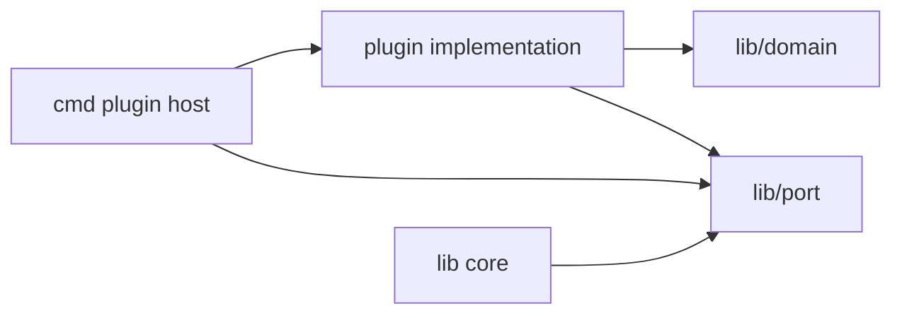
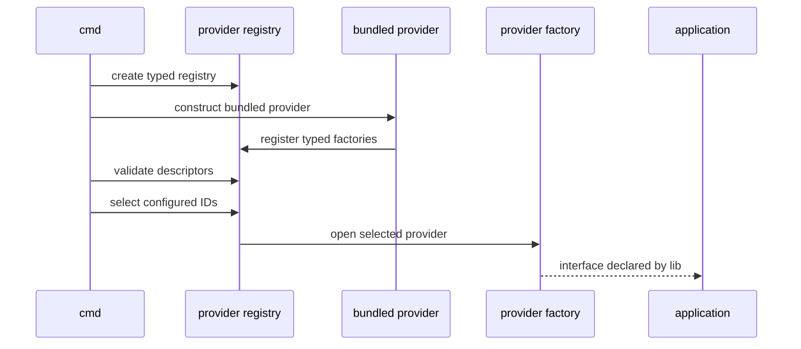

# Plugin Provider

## Responsibility

The `plugin` component supplies concrete implementations of interfaces declared
by `lib`. It adapts platform-specific or policy-specific behavior without
creating a dependency from the common library back to a provider.

Plugins may:

- recognize a CAPTCHA image through an external command or multimodal API;
- load and persist an explicit session snapshot;
- supply optional judge-record updates;
- load optional problem content.

Plugins may not:

- import `cmd`;
- redefine submission parameter policy;
- inspect or replace LGC's `Submission` after construction;
- create a second session cookie jar;
- select or initialize other providers implicitly;
- register themselves through package-level `init` side effects.

## Dependency contract



An implementation imports the port it implements and the value types in its
signature. It never imports a core implementation package solely to reach
process state. If a plugin needs a capability, that capability is expressed by
its factory input or method parameters.

## Public extension ports

The declarations below define the intended shape. Exact naming can change
before implementation.

### CAPTCHA solver

```go
type CaptchaChallenge struct {
	Kind      CaptchaKind
	MediaType string
	Image     []byte
}

type CaptchaSolver interface {
	Solve(ctx context.Context, challenge CaptchaChallenge) (string, error)
}
```

The solver recognizes an already-fetched challenge. The library fetches the
image, preserves cookies, checks expiry, and decides when a login or submission
needs a challenge. Each challenge and answer is single-use.

The first release provides an external-command solver and a multimodal-API
solver. Their shared contract and implementation details are in
[captcha.md](plugin/captcha.md).

### Session store

```go
type SessionStore interface {
	Load(ctx context.Context, profile string) ([]byte, bool, error)
	Save(ctx context.Context, profile string, envelope []byte) error
	Delete(ctx context.Context, profile string) error
}
```

`Load` reports absence separately from an I/O error. `Save` replaces a profile
atomically. `Delete` is idempotent. The envelope comes from the authentication
module's versioned session codec. Stores treat it as opaque secret bytes, may
encrypt the outer storage, and must not log or inspect the payload.

`Save` does not retain the caller's slice after return. `Load` returns a slice
owned by the caller. A store may copy but never alias shared mutable state.

### Record-update source

```go
type RecordUpdateSource interface {
	Follow(ctx context.Context, rid string) (<-chan RecordUpdate, error)
	Close() error
}
```

The channel closes when the subscription ends. Every update is advisory;
`JudgeObserver` still obtains canonical snapshots through HTTP. A source must
not block while sending after cancellation. Polling remains available when the
source is unselected, unavailable, or disconnected.

`Follow` may parse transport frames but must not decide that a record is
terminal. Terminality comes from the runtime status catalog and the core
reducer.

### Problem loader

```go
type ProblemLoader interface {
	Load(ctx context.Context, problemID string) (Problem, error)
}
```

The loader accesses Luogu through an authorized request capability supplied by
its factory. The factory opens the loader after the session capability is
available. The loader returns data only; it does not build or submit a
solution. Problem content is optional and is not required before source-code
submission.

## Provider contract

A plugin bundle may contain multiple provider objects. Each provider object
exposes one typed capability:

```go
type Descriptor struct {
	ID         string
	Version    string
	APIVersion int
	Kind       ProviderKind
}

type Provider interface {
	Descriptor() Descriptor
	Register(ctx context.Context, registrar Registrar) error
}
```

`Provider`, `Registrar`, the descriptor, and the factory types are declared by
`lib/port`. `cmd` implements the host-side `Registrar`; a plugin implements
`Provider` and the selected capability interface. This keeps both dependencies
pointing to `lib` instead of making every plugin import command internals.

`ProviderKind` identifies one of `captcha`, `session_store`, `record_update`,
or `problem_loader`. A provider registers with the matching
method:

```go
type Registrar interface {
	RegisterCaptcha(Descriptor, CaptchaFactory) error
	RegisterSessionStore(Descriptor, SessionStoreFactory) error
	RegisterRecordUpdateSource(
		Descriptor,
		RecordUpdateSourceFactory,
	) error
	RegisterProblemLoader(Descriptor, ProblemLoaderFactory) error
}
```

`Registrar` is implemented by the `cmd` plugin host. It rejects a descriptor
whose kind does not match the registration method, a duplicate ID for the same
kind, and an incompatible API version.

Factories open a capability when their dependencies are ready. A CAPTCHA or
session-store factory generally needs only its own configuration. A record
update source or problem loader also receives a narrow authorized-request
capability from the session. Factories return a typed interface or an error;
they never return an untyped registry value.

The provider abstraction deliberately avoids a registry of `any`. Each
capability remains statically typed at the boundary.

## Registration and selection

First-release plugins are ordinary Go packages linked into `cmd`. At start-up:

1. `cmd` creates an empty, typed registry.
2. The generated or explicitly maintained distribution manifest constructs
   each bundled provider.
3. Each provider registers factories with the registry.
4. `cmd` validates configuration and chooses one provider ID per required
   capability.
5. Selected factories receive only their own configuration.
6. The application uses the resulting interface values.



No provider is activated merely because its package was imported. Importing a
provider affects the build manifest; explicit registration and configuration
determine runtime behavior.

## Built-in provider set

| Capability | Proposed provider ID | Required in first release | Purpose |
|---|---|---|---|
| CAPTCHA | `lgc.captcha.command` | One provider is required when either workflow issues a challenge | Writes the challenge image and invokes a configured program with its path |
| CAPTCHA | `lgc.captcha.multimodal` | Alternative to the command provider | Sends the image and a constrained prompt to a configured multimodal API |
| Session store | `lgc.sessionstore.file` | Yes | Atomic, permission-restricted local snapshots |
| Record updates | `lgc.recordupdate.websocket` | Optional | Low-latency advisory updates |
| Record updates | unselected | Polling default | Polling-only operation |
| Problem loading | `lgc.problem.http` | Optional | Fetches and parses problem content |

Exact provider IDs become compatibility commitments once persisted in user
configuration. Test providers are not part of the distribution manifest.
The two CAPTCHA providers are detailed in
[captcha.md](plugin/captcha.md).

## Configuration and compatibility

A provider descriptor identifies its capability, stable ID, provider version,
and extension API version. Configuration is scoped to the provider:

```json
{
  "plugins": {
    "captcha": "lgc.captcha.command",
    "session_store": "lgc.sessionstore.file",
    "record_update": "lgc.recordupdate.websocket"
  },
  "plugin_config": {
    "lgc.captcha.command": {
      "executable": "<trusted-executable>",
      "args": ["<fixed-argument>", "{image}"],
      "timeout": "20s"
    }
  }
}
```

Rules:

- Unknown provider IDs fail during startup.
- Unknown fields in provider configuration fail validation.
- An incompatible API version fails before command execution.
- Registering the same ID for the same capability is an error.
- A plugin receives only the configuration section addressed to its ID.
- Configuration is data, not an interface through which a provider reaches
  command internals.

The extension API follows the `lib` module's compatibility policy. Additive
interfaces require a new optional interface or a version bump; changing method
semantics is a compatibility change even if the Go signature is unchanged.

## Lifecycle and concurrency

- Registration completes before any command performs network work.
- The registry is read-only after start-up.
- Registration creates typed factories; it does not eagerly create capability
  instances.
- A factory opens its capability only after required inputs are available. A
  capability that borrows a session opens after that session is created.
- An operation-scoped capability is closed at the end of the operation. A
  stateless process-scoped provider may be reused and closed at exit.
- Factories validate configuration and return an error instead of partially
  initialized state.
- A provider implementing `io.Closer` is closed once in reverse initialization
  order.
- Methods may be called concurrently unless their interface documents a
  narrower contract.
- All blocking methods honor `context.Context`.
- A provider does not spawn background work that outlives `Close`.
- Provider errors use the shared `ErrPlugin` category and add only safe context.

In-process plugins are trusted code. The host catches construction errors, not
arbitrary panics or hostile resource use. Isolation is added only if an
external-plugin threat model is adopted.

## Dynamic loading decision

The first release does not use Go's `plugin.Open`.

Reasons:

- Go plugins require exact toolchain and dependency compatibility.
- The mechanism has limited platform support and complicates static release
  artifacts.
- A stable Go interface is not automatically a stable binary ABI.
- Loading arbitrary native code would broaden the security boundary without
  process isolation.

A future external-process plugin system can expose the same capability
semantics through a versioned JSON or RPC protocol. It is a separate design
because it needs discovery, serialization, transport, isolation, timeouts, and
new compatibility rules. It should not silently change the in-process ports.

## Security

- Plugin selection comes from trusted configuration.
- Provider errors and logs redact credentials, cookies, CSRF values, CAPTCHA
  answers, source code, and response bodies.
- A session-store plugin owns persistence but not password collection.
- The CAPTCHA plugin sees one image and returns one answer; it does not receive
  the password or authenticated cookies. The command provider receives a
  restrictive temporary path, not a reusable session file. The multimodal
  provider receives image bytes and a resolved model credential, never Luogu
  cookies or CSRF state.
- The problem-loader plugin gets authorized HTTP access but cannot ask the
  submission core to resubmit or change final parameters.
- Record updates cannot bypass reduction or promote an advisory frame to a
  canonical terminal record.
- Provider configuration paths are resolved according to an explicit policy;
  plugins do not inherit process-global home-directory assumptions.

## Contract tests

Every provider kind gets a reusable contract suite.

- Missing capability and duplicate registration fail deterministically.
- Unknown or incompatible IDs fail during selection.
- Cancellation returns promptly and closes owned work.
- `Close` is idempotent.
- Secret values never appear in `fmt` output or errors.
- A fake CAPTCHA solver receives only the advertised challenge fields.
- A session store distinguishes absent data from read failure and replaces
  profiles atomically.
- An update source closes its channel and never blocks after cancellation.
- A problem loader returns data without invoking the submission workflow.
