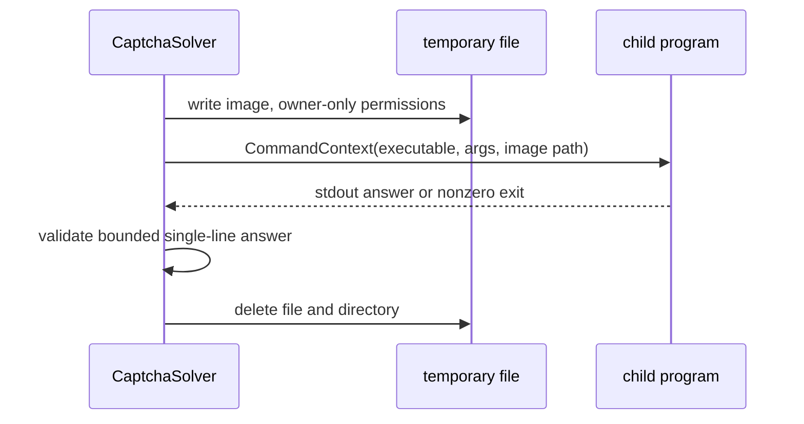

# External Command CAPTCHA Provider

## Provider identity

Provider ID: `lgc.captcha.command`

The provider writes one challenge image to a restrictive temporary file and
invokes a configured executable with the absolute image path. It reads one
answer from standard output.

This provider intentionally provides an automation boundary, not a sandbox.
The configured executable is trusted local code chosen by the user.

## Configuration

```json
{
  "executable": "<trusted-executable>",
  "args": ["<fixed-argument>", "{image}"],
  "timeout": "20s",
  "working_dir": "<optional-directory>",
  "env_allowlist": ["<explicit-variable>"],
  "max_stdout_bytes": 4096,
  "max_stderr_bytes": 4096
}
```

| Field | Rule |
|---|---|
| `executable` | Required; resolved to one program path, never a shell expression |
| `args` | Array of literal arguments containing exactly one argument that is `{image}` |
| `timeout` | Required finite duration; bounded by the caller context |
| `working_dir` | Optional existing directory |
| `env_allowlist` | Optional exact environment names inherited by the child |
| `max_stdout_bytes` | Positive answer-size bound |
| `max_stderr_bytes` | Positive diagnostic-size bound; stderr is not normally printed |

The command host does not interpolate shell syntax, redirects, pipes, globs, or
environment variables. The image path replaces the `{image}` array element
verbatim.

Literal arguments are non-secret configuration. A program that needs a
credential must obtain it from an explicitly allowlisted child environment or
its own platform credential store, not from an argument that could appear in a
process listing.

For example, the effective process invocation is equivalent to:

```text
<trusted-executable> <fixed-argument> <absolute-image-path>
```

No `sh -c` or equivalent is used. This prevents challenge data or a filename
from becoming executable shell syntax.

## Challenge file

For each call the provider:

1. validates the challenge media type;
2. creates an unpredictable per-call directory with owner-only permissions;
3. writes the image bytes unchanged to an owner-only file with a safe extension
   derived from the media type;
4. resolves and passes the absolute file path;
5. runs the program;
6. closes and removes the file and directory on every exit path.

The captured challenge is JPEG, so `.jpg` is a verified first-release mapping.
PNG and other mappings are added only when their media types are observed and
tested. An unknown media type may use a safe extensionless file if the program
can identify the image itself; it is never guessed from untrusted input.

The path is an ephemeral capability. It is not written to ordinary logs, and
the child process must finish reading it before exit.

## Process contract



Execution rules:

- `exec.CommandContext` is created directly with an executable and argument
  array.
- The child receives a minimal environment filtered by `env_allowlist`.
- The image path is not passed through an additional shell parser.
- Standard input is closed or empty unless a later provider variant explicitly
  opts into another contract.
- Standard output and error are bounded while being read.
- A zero exit status and valid answer are both required.
- Nonzero exit includes only the exit status and a redacted bounded diagnostic.
- Timeout or cancellation terminates the process and any owned descendant
  process group where the platform supports it.
- Cleanup runs after success, nonzero exit, timeout, cancellation, and panic
  recovery at the provider boundary.

## Secret and environment handling

The child does not inherit the full coordinator environment by default. This
prevents accidental exposure of Luogu credentials, unrelated API keys, proxy
credentials, or test variables.

`env_allowlist` names exact variables the program needs. Values are inherited
only when present, and variable names or values are never printed. The library
does not pass session cookies or CSRF state through environment variables.

The executable can still read any resource available to its operating-system
user. Documentation must not describe this provider as a security sandbox.

## Errors

| Condition | Error path |
|---|---|
| Missing executable or invalid arguments | `ErrPlugin` at provider construction |
| Temporary file creation failure | `ErrCaptchaRequired` |
| Program cannot start | `ErrCaptchaRequired` |
| Nonzero exit | `ErrCaptchaRequired` |
| Timeout or cancellation | `ErrCaptchaRequired`, wrapping context state |
| Empty or malformed answer | `ErrCaptchaRequired` |
| Output exceeds bounds | `ErrCaptchaRequired` |

The provider never returns partial stdout as a successful answer.

## Tests

- The argument array is preserved without shell expansion.
- Exactly one image path placeholder is required.
- The assigned image path is absolute and exists only for the call.
- File and directory permissions are owner-only on supported platforms.
- Cleanup occurs after success, failure, timeout, and cancellation.
- A process that ignores cancellation is terminated by the provider.
- The child environment contains only explicitly allowed names.
- Large or multiline stdout is rejected.
- Concurrent calls receive distinct paths and answers.
- Error text contains neither the answer nor a secret environment value.
