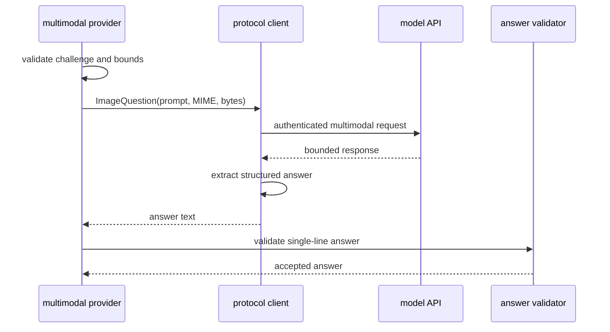

# Multimodal CAPTCHA Provider

## Provider identity

Provider ID: `lgc.captcha.multimodal`

The provider sends one challenge image and a constrained recognition prompt
through a configured multimodal model API, then returns one CAPTCHA answer.

The wire protocol is owned by this plugin. The common library depends only on
`CaptchaSolver`; it does not know the model vendor, request schema, or prompt.

## Configuration

```json
{
  "endpoint": "https://<model-endpoint>/<path>",
  "model": "<model-name>",
  "api_key_ref": "env:<API_KEY_VARIABLE>",
  "timeout": "30s",
  "max_response_bytes": 65536,
  "max_answer_bytes": 256,
  "max_output_tokens": 32,
  "max_transport_retries": 1
}
```

| Field | Rule |
|---|---|
| `endpoint` | Required HTTPS URL; credentials are not embedded in it |
| `model` | Required provider-specific model identifier |
| `api_key_ref` | Required secret reference; never a literal key |
| `timeout` | Required finite duration, including response-body read |
| `max_response_bytes` | Positive bound before JSON decoding |
| `max_answer_bytes` | Positive bound after answer extraction |
| `max_output_tokens` | Small positive model-output budget |
| `max_transport_retries` | Small finite bound for transient failures |

The command host resolves `api_key_ref` and passes the secret through a
redacted value to the provider. The plugin does not scan the process
environment itself and configuration files never contain the resolved key.
The first-release secret scheme is `env:<NAME>`, resolved once when the selected
provider is opened.

If the chosen API is OpenAI-compatible, its adapter can map the same
`ImageQuestion` into that API's multimodal request format. Supporting another
protocol adds another client adapter behind the plugin's internal interface;
it does not change `CaptchaSolver`.

## Internal client seam

The provider normalizes vendor-specific APIs through one internal interface:

```go
type ImageQuestion struct {
	Prompt    string
	MediaType string
	Image     []byte
}

type MultimodalClient interface {
	Recognize(ctx context.Context, question ImageQuestion) (string, error)
}
```

`ImageQuestion` is not a public library port. It lets one provider implementation
support multiple API protocols while keeping `CaptchaSolver` stable.

## Request design

The protocol adapter must send the following semantic inputs:

- the configured model identifier;
- one instruction to transcribe the visible CAPTCHA text;
- one instruction to return only a machine-parseable answer object;
- the challenge MIME type;
- the exact challenge image bytes, encoded by the protocol adapter.

The default prompt is fixed by LGC and can be overridden only through trusted
provider configuration. It must not ask for chain-of-thought, explanations,
confidence, translation, or code.

Example desired model result:

```json
{
  "answer": "<captcha-text>"
}
```

The adapter parses the response according to its own protocol, extracts the
answer field, and hands only that string to shared answer validation. It does
not use a broad regular expression that can turn prose into a guessed answer.

The request sets a small model-output budget appropriate for a short CAPTCHA
label. Exact API field names, image encoding, and structured-output mechanism
belong to the selected protocol adapter.

## Request flow



The endpoint is HTTPS unless a future explicit test-only override is added.
Normal certificate verification remains enabled. Cross-origin redirects are
rejected so the authorization header and image cannot be forwarded to another
origin.

The provider owns a dedicated HTTP client and does not reuse the Luogu session's
`http.Client`, `http.Transport`, or cookie jar. The API credential is sent only
in the protocol adapter's authorization mechanism, never in the URL or a
cookie.

## Retry policy

The client may retry only transient transport failures, HTTP 429, and selected
5xx responses within `max_transport_retries`, using bounded backoff and the
same challenge image.

It does not:

- repeat a request after invalid model output with a prompt that guesses more
  aggressively;
- retry authentication failures;
- follow an unrelated redirect;
- submit to Luogu again;
- reuse an answer for another challenge.

If the CAPTCHA branch remains unsolved, `SubmissionExecutor` stops after its
single verified retry. The caller can start a new submission operation later.

## Answer handling

The model result must produce exactly one answer. The provider rejects:

- an empty or refusal response;
- multiple answer candidates;
- explanatory prose instead of the required structured field;
- code fences around an otherwise plausible answer;
- multiple non-empty lines;
- control characters or an oversized result.

The provider does not use confidence claims or chain-of-thought. A model saying
that it solved the CAPTCHA is not evidence; only a valid answer returned by a
successful HTTP exchange can be submitted.

## Privacy and security

Sending a challenge to an external model is explicit opt-in through provider
selection. The design must make that egress visible in configuration
documentation and diagnostics.

- The provider sends the image, fixed prompt, model name, and API credential.
- It does not send the Luogu password, cookie jar, CSRF token, problem ID,
  source code, or session snapshot.
- No Luogu cookie jar is attached to the model request.
- It never logs the image, base64 request body, authorization header, raw model
  response, or final answer.
- Request and response bodies are bounded.
- The API key exists only as a resolved secret in memory and is redacted from
  errors.
- No challenge image is persisted by default after the request completes.
- External provider retention and training behavior remains outside LGC's
  control and must be described by the chosen service.

## Errors

| Condition | Error path |
|---|---|
| Missing endpoint, model, or secret reference | `ErrPlugin` at construction |
| Secret resolution failure | `ErrPlugin` without revealing the reference value |
| Request timeout or cancellation | `ErrCaptchaRequired` |
| TLS, authentication, or non-retryable HTTP failure | `ErrCaptchaRequired` |
| Response above bound or malformed JSON | `ErrCaptchaRequired` |
| No single structured answer | `ErrCaptchaRequired` |
| Invalid or oversized answer text | `ErrCaptchaRequired` |

Provider diagnostics contain the provider ID, safe HTTP status, and retry
count. They never contain the key, prompt/image body, or raw response.

## Tests

- The exact challenge MIME type and bytes reach the protocol adapter.
- HTML, multiline, prose, and multiple-answer outputs are rejected.
- A valid structured answer passes shared validation.
- API keys are absent from errors, fixtures, logs, and configuration dumps.
- Transient failures respect the retry bound and cancellation.
- Authentication failures and cross-origin redirects are not retried.
- Response size is bounded before decoding.
- Concurrent calls do not share result state or image buffers.
- A model failure never triggers an extra Luogu submission.
- The same provider contract suite passes as for the command provider.
