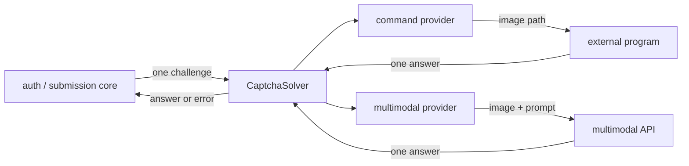

# CAPTCHA Providers

## Responsibility

CAPTCHA providers turn one fetched image challenge into one answer. The common
library owns challenge acquisition, cookie updates, expiry, and the decision to
retry a login or submission. A provider owns only image-to-answer conversion.

The first release has two implementations behind the same interface:

| Provider ID | Strategy | Detailed design |
|---|---|---|
| `lgc.captcha.command` | Write the image to a temporary path and invoke a configured program | [captcha-command.md](captcha-command.md) |
| `lgc.captcha.multimodal` | Send the image and a constrained prompt to a configured multimodal API | [captcha-multimodal.md](captcha-multimodal.md) |

The configuration selects exactly one provider. It is used by `login` and by
the conditional submission CAPTCHA branch. The library does not silently fall
back to another solver because the two strategies have different privacy,
latency, and failure behavior.

## Common interface

```go
type CaptchaKind string

const (
	CaptchaLogin      CaptchaKind = "login"
	CaptchaSubmission CaptchaKind = "submission"
)

type CaptchaChallenge struct {
	Kind      CaptchaKind
	MediaType string
	Image     []byte
}

type CaptchaSolver interface {
	Solve(ctx context.Context, challenge CaptchaChallenge) (string, error)
}
```

The challenge bytes are exactly what the upstream challenge response returned.
The provider does not refetch the image or mutate Luogu cookies. The library
retains ownership of the input slice for the duration of the call; a provider
must copy it if work continues beyond return.



## Answer contract

Both providers return the same value shape and apply the same validation:

- output must be valid UTF-8;
- surrounding spaces and line terminators may be removed;
- internal characters are not lowercased, reordered, or guessed;
- empty output, multiple non-empty lines, control characters, or output above
  the configured limit are failures;
- no answer is cached or reused after the call.

Answer validation is shared by a CAPTCHA contract test. The core does not know
whether the answer came from a program or a model.

The authoritative normalization helper lives in the common library. The login
and submission workflows call it once immediately after `Solve`; a provider can
call the same helper for early failure, but the core still validates the value
it receives. A custom provider cannot bypass the final answer constraints.

## Configuration

Provider selection is explicit:

```json
{
  "plugins": {
    "captcha": "lgc.captcha.command"
  },
  "plugin_config": {
    "lgc.captcha.command": {
      "executable": "<trusted-executable>",
      "args": ["<fixed-argument>", "{image}"],
      "timeout": "20s"
    }
  }
}
```

The command provider is the default example because it does not require a
remote service. It still has no implicit default executable. A missing,
invalid, or unreachable selected provider fails during `login` setup or when
the first challenge is solved.

Provider configuration contains no Luogu password, cookie, CSRF token, or
CAPTCHA answer. Model API keys are secret references resolved by the command
host and passed only to the selected provider.

## Lifecycle and concurrency

- A solver factory validates configuration before the first challenge.
- A solver may receive concurrent `Solve` calls; each call has an independent
  temporary resource and cancellation path.
- One `Solve` call produces at most one answer.
- A timeout, process failure, API failure, or invalid answer returns a typed
  CAPTCHA error.
- Provider shutdown cancels outstanding work and removes resources.
- The provider never starts a background retry of the submission itself.

## Failure boundaries

| Condition | Result |
|---|---|
| Provider not selected or invalid | `ErrPlugin` before login |
| Challenge image empty | `ErrCaptchaRequired` |
| Solver timeout or cancellation | `ErrCaptchaRequired`, wrapping the cause |
| Solver exits abnormally | `ErrCaptchaRequired` |
| Solver produces invalid output | `ErrCaptchaRequired` |
| Login challenge answer rejected | The authentication flow obtains a fresh challenge |
| Submission CAPTCHA retry rejected | `SubmissionExecutor` stops; it does not submit again |

A transient failure inside the multimodal HTTP client may be retried within
that solver call. That retry reuses the existing image and does not resend the
Luogu submission.

## Security

- Neither implementation receives the account password, Luogu cookies, or CSRF
  tokens.
- The command provider treats the program as trusted local code and passes only
  a restrictive image path plus explicitly configured arguments.
- The multimodal provider treats external image egress as an explicit user
  choice and uses HTTPS with normal certificate verification.
- Images, answers, API keys, process arguments containing secrets, and raw
  provider responses never appear in normal output or errors.
- Challenge files and in-memory image copies are removed after each attempt.
- A challenge page cannot select, configure, or launch a provider.

## Contract tests

- Both providers satisfy the same challenge and answer contract.
- Empty, multiline, control-character, and oversized answers fail.
- Surrounding whitespace is handled consistently.
- Cancellation returns promptly and removes provider resources.
- Concurrent calls do not share challenge files or mutable image buffers.
- Provider errors never include secrets or raw responses.
- A solver failure never causes a duplicate Luogu submission.
